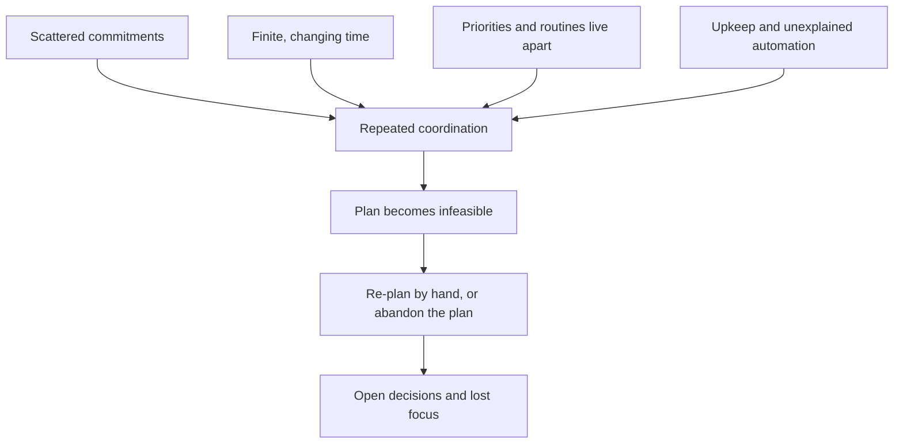

# Phase 4: Solution Design

**Working title:** Life OS, the day that repairs itself with your say-so

> **Solution in one sentence.** When your day breaks, Life OS shows what still fits, proposes the smallest repair with its reasons, and leaves the final call to you.
>
> **The problem it answers.** A late meeting forces you to rebuild the afternoon by hand across a list, a calendar and a timer, and you can't tell whether the new plan is better.

> **Status, 11 Oct 2026 (India time).** Desk research and design synthesis only. **No co-creation, no usability test and no A/B test has been run.** Everything under "Validation" is a plan with targets, tagged *planned, not run*. Life OS capabilities come from the builder's README as summarized in the earlier draft. We haven't seen the README in this session or audited the product. Tags: **[E]** verified source, **[S]** synthetic, **[H]** hypothesis, **[C]** constructed example.

> **Continuity checkpoint (unchanged from Phases 1 to 3).**
> **HMW:** How might we help self-managing knowledge workers in India turn scattered work and personal commitments into a realistic, adaptable daily plan that remains calm enough to use throughout the day?
> **Target user:** India-based, English-speaking knowledge workers who set their own priorities and keep a flexible or hybrid calendar.
> **Geography:** India first. **Team:** solo (Divy Sharma).
> **Chosen problem:** capacity-aware re-planning after disruption.
> **Ruled out as lead:** the lost thread, execution switching, priority ambiguity.
> **Constraints carried from Phase 3:** works without a daily ritual; adds no upkeep; explained, reversible changes; the calendar isn't the whole truth.

---

# Page 1

## Background: how we got here

Phase 1 found that the day changes faster than three or four tools can follow. Phase 2 found that most of the plan belongs to other people and that the market documents re-planning but never explains a move. Phase 3 scored eight problems and picked re-planning after disruption, even though it came third on the score, because four other problems hang off it.

## Cause and effect tree

Every cause below appears in Phases 1 to 3. The links are a synthesis model, not measured effects.

"Repeated coordination" breaks into six sub-causes: unknown durations, unclear commitment state, no visible trade-off, a stale plan by 2 PM, the same blocks dragged around again, and moves that arrive with no reason. The design target is the **re-plan step**, because the symptoms downstream follow from it.

*Visual elements to design:* the tree as a left-to-right flow with the re-plan node highlighted in coral; the six sub-causes as small chips under "repeated coordination".

## Reactivated evidence

| Stat | Source |
|---|---|
| **78%** of Indian workers lack uninterrupted focus during the workday | Microsoft India Work Trend Index, 1 Jun 2023 [E] |
| **~1,200** toggles per user per day, just under **4 hours** a week reorienting (about 9% of annual work time) | Murty, Dadlani and Das, HBR: 20 teams, 137 users, three Fortune 500 firms, non-India sample [E] |

Neither number says Life OS fixes anything. They say the problem is big enough to test.

## Need statement (verbatim from Phase 3)

> **Self-managing knowledge workers in India** need **a low-effort way to repair their day when it breaks, seeing what still fits, what carries over and what only they know is firm, with every consequential change explained and theirs to accept, edit or reject,** so that **they can stop rebuilding the day by hand and end it knowing what comes next.**

## Current, challenge, vision

| Current reality | Challenge | Vision |
|---|---|---|
| A late meeting breaks later blocks | You decide what moves, from scratch | Repair proposes trade-offs, you confirm |
| Calendar shows fixed time | Free space isn't focus capacity | Real focus capacity is visible |
| Tasks sit in a backlog | A backlog gets mistaken for capacity | The day shows what actually fits |
| AI suggests things | Silent changes cost trust | Each suggestion shows reason, consequence and undo |

## Design principles

1. **Repair first.** Every screen earns its place by helping when the day breaks.
2. **Work without a ritual.** The product must help someone who never planned the morning.
3. **Suggest, never act silently,** for any change that moves something.
4. **Ask only when the answer changes the plan.**
5. **Show the arithmetic.** Capacity is a visible calculation, not a hidden score.
6. **Defer is a decision,** not a failure.

## Ideation: the how-to questions that shaped features

How could we...

1. show what still fits right after a change? (Feature 1)
2. show what the AI displaced, and why? (Feature 1)
3. let the user mark what's firm that isn't on any calendar? (Feature 2)
4. repair a day without making the user rebuild it? (Feature 3)
5. make undo cheap and obvious? (Feature 3)
6. keep capture and starting work light, with no ritual? (Feature 4)
7. let the user close the day without a guilt report? (Feature 5)
8. make "defer" feel intentional? (Principle 6)

## Concept variants explored

| Variant | Mechanism | Verdict |
|---|---|---|
| A. Capacity worksheet | Show finite time; the user resolves it by hand | **Kept as baseline.** Cheapest, and it may be enough |
| B. Reviewed repair proposal | Calculate constraints, preview, user commits | **Preferred hypothesis.** Review effort could erase the gain |
| C. Optional auto-adjust | Move eligible tasks within user-set bounds | **Test later.** We don't assume opaque automation is wanted |
| D. "Everything in one app" | Win on feature count | **Rejected.** Motion, Sunsama, Akiflow and TickTick already list the same ingredients |

If the worksheet gives the same benefit with less effort, it wins. The AI has to add something beyond arithmetic and priority rules.

*Visual elements to design:* four variant cards in a row, the preferred one raised and outlined, the rejected one greyed.

## Co-creation and testing status

**Not conducted.** The plan is on Page 4. What did happen: a synthetic dry run of the Phase 1 interview guide with three invented personas (`supporting/05-simulated-interviews.md`). It produced hypotheses and guide fixes, and it counts as no validation.

## Challenges conquered (research humility)

- **Web search was blocked** in this environment, so every source was opened and read directly. That limited the market scan to vendor pages.
- **Reddit was unreachable,** so the Phase 1 forum leads were dropped, and four Hacker News comments replaced them.
- **Three claims changed on re-reading.** We first said no competitor describes re-planning. Their feature pages show Motion, Akiflow and Sunsama do. We first said "interrupted every two minutes" for everyone. It's the top 20% of users by ping volume. We first listed the India figures as one survey. They come from three.
- **The lead problem is a judgment call.** It came third on score and won on a causal argument. A reviewer could reasonably pick differently.

---

# Page 2

## Concept description

**Life OS (Your Daily Operating System)** already combines tasks, calendar, habits, focus sessions, workflows and an AI assistant, per the builder's README [unaudited]. Phase 4 changes the pitch from *components* to *the job they do together*.

| Before (components) | After (research-narrowed) |
|---|---|
| One place for tasks, habits, calendar, focus, workflows and AI | **When your day breaks, show what still fits, propose the smallest repair with reasons, and keep the final call yours** |

**Name.** *Life OS* stays. The positioning line is a copy hypothesis to test, not a brand.

## Primary stakeholders

| Who | Role in the product |
|---|---|
| The knowledge worker | Owns the plan and the final trade-off |
| Teammates, managers, clients | Create the meetings and requests that change capacity |
| Household, health and routines | Legitimate commitments, not leftover time |
| Connected services | Google Calendar supplies external events |
| The AI layer | Assists; never owns the decision |

## Five features, each tied to the finding it answers

*The before and after moments use invented names. They are illustrations, not users.*

### Feature 1: Repair Preview (the headline)

**Answers:** Phase 3 chosen problem; Phase 2 gap that no page explains a move.

**How it works.** When a meeting overruns or a request lands, the product shows a four-part card: **Trigger, Reason, Consequence, Control.** Control means accept, edit, dismiss or undo. It proposes the smallest change that restores a feasible day and states what it displaced.

**Before:** at 2 PM Kabir's meeting runs 45 minutes over. He rebuilds the afternoon by hand, or gives up.
**After:** he reads a four-line preview, taps accept, and sees an undo button.

*Repair preview [C], constructed example:*

| Field | Content |
|---|---|
| Trigger | Capacity drops from 185 to 140 minutes after a meeting runs 45 minutes over |
| Demand | 170 minutes, so 30 over |
| Proposal | Defer the 35-minute client notes (no deadline today) |
| Preserved | Synthesis, launch review, protected routine |
| Result | Demand 135 minutes; 5 left, if a valid slot exists |

No tomorrow slot is promised until its availability is checked.

### Feature 2: Mark What's Firm

**Answers:** Phase 3 constraint "the calendar isn't the whole truth"; the invisible-commitment hypothesis [S][H].

**How it works.** One tap marks any item, on or off the calendar, as **Firm** (the repair must not move it) or **Flexible**. Anything the user pinned in their head can be pinned in the product. The repair treats Firm items as fixed.

**Before:** Ananya's auto-scheduler moves a deep-work block over a call prep she was holding only in her head. She quits it after two weeks [S].
**After:** she marks call prep Firm in one tap, and the repair routes around it.

### Feature 3: Capacity View

**Answers:** Phase 3 "capacity-blind planning"; Phase 2 branch C.

**How it works.** Calendar events become *remaining executable capacity*. Every item has a state.

| State | Meaning |
|---|---|
| Fixed | Meetings and appointments |
| Firm | Marked by the user; the repair can't move it |
| Flexible | Can move inside a window |
| Unscheduled | Important, no time yet |

**Capacity rule.** C is the planning window minus unavailable time, with overlaps counted once. L is the remaining duration of selected tasks. Overload is L minus C, shown when positive. A task already blocked on the calendar sits in L only, never subtracted from C as well.

*Worked arithmetic [C]:*

| Today's budget | Minutes |
|---|---:|
| Planning window | 540 |
| Fixed meetings | −190 |
| Protected routines not already on the calendar | −45 |
| Breaks | −30 |
| Transition allowance (user-chosen) | −90 |
| **Task capacity** | **185** |
| Planned tasks (90 + 45 + 35) | 170 |
| **Left** | **15** |

Add a 60-minute task and you are 45 over. The 90-minute allowance is an example input, not a recommended reserve.

**Edge states, each one to design:**

| Situation | Behavior |
|---|---|
| Unknown duration | An editable range, labeled "capacity uncertain" |
| Free time only in small gaps | Check minimum block size before calling it feasible |
| Calendar stale or disconnected | Label capacity "provisional," show freshness, offer manual mode |
| A task overruns | Recompute the remaining time, not estimate plus elapsed |
| Overlapping meetings | Count the union once; show the conflict |

**Before:** Arjun's calendar says 3 free hours, but two of them are 20-minute gaps.
**After:** the day shows 95 usable focus minutes and why.

### Feature 4: Light Capture and One-Tap Start

**Answers:** Phase 1 reorientation cost (~1,200 toggles); Phase 3 constraints "no upkeep" and "no ritual".

**How it works.** Quick Add saves a task with no required field. The product asks for a deadline or a duration range (15, 30, 60, 90 or more, or "not sure") only when the answer changes the plan. "Start" on any item opens a focus session carrying the title, duration and subtasks, and at the end asks *Completed, Continue 15 minutes, Needs another block, or Blocked.* The answer updates the rest of the day.

**Before:** every captured task demands a project, tag, date and estimate, so Tara stops capturing.
**After:** she types "prepare quarterly review", hits enter, and gets asked one question that morning.

This feature must work for someone who never opens a morning plan. The Adaptive Executor persona is the test case [S].

### Feature 5: Optional Close of Day

**Answers:** Phase 1 attention residue (Leroy, title only); Phase 2 open loops; the "end it knowing what comes next" clause of the need statement.

**How it works.** An optional evening card lists open items with three choices: keep, defer, drop. It closes open decisions instead of reporting guilt. It's optional because Phase 3 ruled out any required ritual. Sunsama and Akiflow already name shutdown rituals, so this is parity, not a wedge.

**Before:** Sneha carries five undecided tasks in her head into the evening.
**After:** she spends 90 seconds on a keep, defer, drop list and stops thinking about work.

## AI interaction rules

Grounded in Microsoft Research's *Guidelines for Human-AI Interaction* (validated in a CHI 2019 study): efficient dismissal (8), efficient correction (9), scope when in doubt (10), explain why (11), update cautiously (14), convey consequences (16) [E].

| # | Rule | Say | Avoid |
|---|---|---|---|
| 1 | Suggestion, not command | "Your plan looks 45 min over capacity. One way to recover:" | "I fixed your schedule." |
| 2 | Explain at decision time | The reason sits on the card | Reasoning buried in a chat log |
| 3 | Cheap correction | "Never move this routine." | Starting over |
| 4 | Learn cautiously | One overrun nudges the duration model | Rewriting it from one data point |
| 5 | Reversible | Preview and undo on any multi-item repair | Silent bulk moves |
| 6 | Respect attention | Prompt only when it removes a real decision | Constant "helpful" nudges |

## What stays in the background

Kanban boards, nested lists, folders, the Eisenhower matrix, the habit gallery, memories and rich text remain available as depth. **Rule: show the complexity needed for the current decision, not the whole product.**

## Information architecture (a recommendation, not the current UI)

Seven items, each a user question: **Now** (what's breaking, what fits?), **Inbox** (captured but undecided?), **Plan** (the next week), **Focus** (run the current block), **Routines** (what I protect), **Workspaces** (lists, boards, workflows), **Assistant** (ask for planning help). **Now** comes first, and it works without a morning plan.

*Visual elements to design:* five feature cards in an isometric style, the Repair Preview card largest; one before and after strip per feature; the IA as a seven-tab bar.

---

# Page 3

## Service flow: ten steps, from a broken day to a clear next step

| # | Step | Design rule |
|---|---|---|
| 1 | Connect context (hours, boundaries, optional calendar) | Explain data use; skippable |
| 2 | Capture as things arrive | Cheaper than remembering |
| 3 | Mark what's firm | One tap, on or off the calendar |
| 4 | See what fits | A decision summary, not a dashboard |
| 5 | Surface overload before commitment | "75 min over" beats a red icon |
| 6 | Start work from the plan | Planning collapses into action |
| 7 | Record state: done, blocked, needs time, continue | Feedback updates the day |
| 8 | Detect meaningful disruption | Ignore trivial drift |
| 9 | Propose a repair | Preview first; the user confirms |
| 10 | Close the day, optional: **fewer open decisions than it opened with** | Closing costs less than the upkeep it replaces |

Steps 6 to 9 loop: if the day changes again, a new preview returns the user to a confirmed plan (accept or edit) or leaves the plan in place with a visible conflict (dismiss). Step 10 is the systemic outcome. It depends on real evidence and isn't an observed result.

## Service blueprint

| Moment | User action | Foreground | Background | Infra |
|---|---|---|---|---|
| Day starts | Opens Now | Fixed / firm / fits / next | Busy-interval union; capacity C against demand L | Calendar sync, local store |
| Add a task | Quick Add | Cost shown before it lands | Recompute L minus C | Same |
| Start work | Taps Start | Session with task context | Link session to task | Timer service |
| Block ends | Picks an outcome | Remaining plan updates | Recompute durations | Same |
| Day breaks | Reads the repair preview | Trigger, reason, consequence, controls | Constraint and stale-proposal check | Calendar poll, AI layer |
| Evening | Closes open items | Keep / defer / drop list | Carryover and overrun record | Same |

## Edge and error states

| Situation | Behavior |
|---|---|
| No tasks today | No pressure: "Nothing needs you. 2h 40m open if you want to pull something forward." |
| Calendar disconnected | Plan from declared work windows; say meeting conflicts aren't included |
| Day full of meetings | Don't cram tasks into tiny gaps; help pick the few essentials |
| Urgent tasks don't all fit | Force a trade-off; never imply all fit |
| User ignores the plan for hours | Offer "Rebuild from now" |
| AI confidence low | Ask a question or offer options |
| Personal commitment against work | Respect the declared boundary; don't auto-demote |
| AI unavailable | Capacity math and manual repair still work |

**State contracts to test in a prototype (not claimed as shipped).** An external edit after a preview marks the proposal stale. A task on both calendar and app counts once. A partly failed multi-item proposal shows what succeeded and never a false "all done". Undo after new calendar changes restores only what is still safe. Repair, defer and undo work by keyboard and assistive tech without drag-and-drop.

## FAQs

**1. Will AI move my calendar events without asking?**
Not by default. Anything that moves gets a preview. Users can leave tasks unscheduled and opt into more automation once trust exists. The right default is a testing question.

**2. Why not just a calendar or a task manager?**
A calendar shows time but not priority or backlog. A list shows commitments but not whether they fit. Neither explains why something moved after a meeting overran.

**3. What data does the AI need, and must I enter durations?**
Durations are optional (buckets or "not sure"). The AI gets the minimum: selected tasks, calendar availability, declared priorities and Firm marks. The README sets no retention or model policy as far as we know, so a privacy spec comes before launch.

**4. How is this different from Motion, Sunsama, Akiflow or TickTick?**
It isn't a unique ingredient. Motion re-plans, Akiflow has a "replan" button and Sunsama's other tasks auto-adjust around a locked one. The bet is a behavioral stance: show the reason, let the user mark what's firm, keep the final call with the user. That bet is unproven.

**5. What if I don't plan my mornings?**
Feature 1 and Feature 2 don't need a morning plan. Feature 4 captures and starts work without one. A user who never plans should still see a repair preview after a late meeting. That's the test case for the Adaptive Executor persona [S].

**6. What happens when the calendar is out of date?**
Capacity shows as "provisional" with a freshness label, and the product offers manual mode. A preview that depends on stale data is marked stale before it can be accepted.

---

# Page 4

## Benefits, each traced to a feature

**Realistic** (Features 1, 3). **In control** (Features 1, 2). **Calm** (background rule). **Focused** (Feature 4). **Light** (Feature 4). **Recoverable** (Feature 1). **Less guilty** (Feature 5, Principle 6).

## Framework return (Phase 1)

Phase 1 named **Cognitive Load, Time Control, Focus and Trust and Agency** as primary, with Follow-through and Wellbeing as ripple effects. The solution claims no more than that.

| Dimension | Coverage | Mechanism |
|---|---|---|
| Cognitive Load | **Primary** | One Now view, progressive clarification |
| Time Control | **Primary** | Capacity, states, overload shown early |
| Focus | **Primary** | Plan-to-session link |
| Trust and Agency | **Primary** | Reason, preview, edit, undo, Firm marks |
| Follow-through | Ripple | Execution state, adaptive repair |
| Wellbeing | Ripple | Feasible scope, optional close; no clinical claims |

*Visual elements to design:* the Phase 1 radar returns with the four primary axes filled and a feature number marked on each.

## Impact: five statements, each tied to a feature

| Impact | Feature |
|---|---|
| **Overload shows up before it becomes failure** | 1, 3 |
| **A disruption costs a few trade-offs, not a rebuild** | 1 |
| **What only the user knows stays protected** | 2 |
| **Starting work is one tap, with or without a morning plan** | 4 |
| **AI assists rather than manages** | 1, 2 |

All conditional on validation; none observed.

## Competitive reality check (official pages read 11 Oct 2026)

| Product | Documented capability | What it means for us |
|---|---|---|
| TickTick | Calendar views, habits, Pomodoro, Eisenhower matrix; no AI or time blocking named | Breadth is table stakes |
| Sunsama | Projections that "spot overload before it happens"; a locked task with others that "auto-adjust"; five-step ritual | The closest challenger. Benchmark head to head |
| Motion | "Automatically re-plans your day"; flags when "you've scheduled more than you can handle" | Auto-replan and overload warnings exist. Don't claim they're missing |
| Akiflow | Rituals, lock time, "replan undone tasks"; AI assistant in Beta | Consolidation and re-planning exist |

Capacity awareness and re-planning aren't exclusive to us. What has to be earned is lower effort, clearer decisions and a shown reason, for a defined segment.

## Validation plan: *planned, not run*

No result exists. The targets below are proposed gates for a first round.

| Stage | Who and how | Gate |
|---|---|---|
| **A. Problem check** | 12 target users (8 with a recent disruption, 4 satisfied), a 45-minute contextual interview plus a three-workday diary, screened on "do you plan most mornings?" | Go on only if real episodes show recoverable planning effort and users control some commitments. If pain is workload, missing inputs or task initiation, revise the problem. If many lost a task for a day or more, promote the lost thread to lead |
| **B. Co-create** | 6 of the Stage A users, 60 minutes. Compare worksheet, reviewed proposal and optional auto-adjust on one disrupted-day story | Collect rationale and objections. **No approval percentages from n=6** |
| **C. Comparative usability** | 12 new users, 60 minutes each, a clickable prototype and fictional data. Manual repair against reviewed suggestions, counterbalanced (6 each order), same information in both | See thresholds below |
| **D. Pilot** | 12 users, a three-day baseline then seven days of use | Directional only. Can't show retention |

Stage C is a small counterbalanced usability comparison, **not a powered A/B test**. It has no live traffic and no power calculation.

**Fixed test case [C].** Afternoon 13:00 to 17:00, 150 task minutes available, demand 150. The meeting ends 45 minutes late, leaving 105 available against 150 demand: **45 over**. One valid repair defers the 45-minute launch review and keeps the protected routine. Any other safe trade-off counts as a pass.

| Criterion (N = 12) | Proposed gate |
|---|---|
| Independent feasible planning | at least 10/12 |
| Independent disruption repair | at least 9/12 |
| Correct consequence explanation before accepting | at least 10/12 |
| Finds edit, dismiss and undo without help | at least 11/12 |
| Repair speed | median paired time at least 20% faster than manual |
| Perceived control | median at least 4/5, no drop against manual |
| A Firm item moved unnoticed, or an external change not approved | **zero** |

Report raw counts (9/12), not percentages. Revise even on a pass if one serious misunderstanding repeats.

**Pivot rules.** If inspecting a suggestion is slower than repairing by hand, keep capacity visibility and drop the AI. If duration entry dominates effort, test ranges and fewer commitments. If competitors already meet the need, find a real migration barrier or stop.

**Results:** participants, prototype version, success counts, paired times, comprehension, changes from evidence. All *not conducted*.

## Success metrics (targets, not achievements)

Measure these separately before combining any: **feasible-plan rate**, **repair completion**, **repair time** (cue to confirmed resolution), **consequence comprehension** (the user names the changed item, the new timing and the preserved boundary), **perceived control** (1 to 5), **setup and upkeep effort**, **Firm-mark use**, **intentional closure** (unfinished items deliberately kept, deferred or dropped).

Log events such as `capacity_conflict_shown`, `repair_accepted`, `repair_dismissed`, `repair_undone`, `firm_marked` and `focus_started`. Never log task titles, event text or routines.

## Roadmap

| Step | Scope | Evidence needed before the next |
|---|---|---|
| 1. Prototype the core | Now view, editable capacity, Firm marks, manual trade-offs | Users read feasibility and adjust unaided |
| 2. Prototype repair | Proposal, preview, edit, dismiss, undo, stale states | Beats matched manual repair |
| 3. Pilot integrations | Freshness, deduplication, partial-failure recovery | No surprise external changes |
| 4. Add intelligence | Recommendations beyond deterministic rules | Value exceeds review effort |
| 5. Expand | More providers, learning, mobile | Repeat use and a measured need |

**Don't build first:** more Kanban templates, dashboard widgets, streak games, autonomous calendar moves without a trust model, another AI chat entry point, team features.

## Scalability: three different axes

| Axis | Direction | Constraint |
|---|---|---|
| Intelligence depth | Learn duration ranges, spot recurring overload, tune the automation level | Learning stays visible and correctable |
| Ecosystem breadth | More calendar providers, task sources, MCP connections, import without forced migration | Each integration cuts coordination and doesn't add a sync state |
| Platform continuity | Mobile: capture, the current plan, quick repair, focus, check-in | Not every desktop settings screen. Mobile is roadmap, not shipped |

Business model, pricing and unit economics are untested. We propose no rupee price or revenue figure.

## Reflection: what we'd change

| Honest gap | Fix |
|---|---|
| Zero primary research across all four phases | Run Stage A first. It can still kill the idea |
| The builder wrote both the README and this case study | Audit what the product does before describing it |
| Sunsama may already solve most of this | Test it side by side in Stage C |
| The capacity formula assumes users can estimate | Try to disprove that first |
| The lead problem came third on score | Add scorers, and let Stage A promote the lost thread if the data says so |

## Decision log (grill-me run, 11 Oct 2026)

| # | Question | Decision | Made by |
|---|---|---|---|
| D1 | Narrow to a Cohere-style cohort, or keep the broad India framing? | Keep the broad India framing | Divy |
| D2 | Run real interviews now, or simulate? | Simulate with personas now, plan real interviews as Stage A | Divy |
| D3 | Which problem leads Phase 3? | Re-planning after disruption leads; the lost thread becomes a constraint. Reversible after real interviews | Claude, at Divy's request |

## Closing

Life OS won't win by listing tasks, calendar, habits, focus and AI, because TickTick, Sunsama, Motion and Akiflow list them too. It has a shot if it does one thing they don't describe: when your day breaks, it shows what still fits, tells you why it would move something, and lets you say what's firm. The next artifact is a clickable Now and Repair Preview prototype, tested with 12 real people.

---

## Evidence confidence

**High:** focus scarcity (Microsoft India WTI), competitor overlap (official pages), explainability and control as AI design principles (Microsoft Research guidelines). **Medium-High:** app-switching cost (HBR, non-India sample). **Medium:** Life OS has the primitives (README only, unaudited). **Low-Medium:** re-planning is the right lead problem (a causal argument, no primary data). **Low until tested:** the repair preview saves time or improves focus.

## Self-Audit Scores

| Dimension | Score | Justification |
|---|---|---|
| AI-Likeness | 3/10 | Constructed numbers are tagged, edge states are concrete, and claims carry confidence labels |
| Research-to-Solution Traceability | 9/10 | Every feature names the finding it answers, the need statement is verbatim, and the Phase 1 framework returns |
| Solution Concreteness | 8/10 | Five features, a ten-step flow, blueprint, AI rules, edge states and IA; the product name is inherited, not designed here |
| Validation and Impact Sharpness | 3/10 | A runnable plan with gates exists, but no real participant has touched it |

**Weakest dimension:** Validation and Impact Sharpness. Running Stage A with 12 real users is the single biggest improvement.

## SUCCESs check

| Principle | Where it shows |
|---|---|
| Simple | A one-sentence solution and a one-sentence problem open the document |
| Unexpected | The plan tests whether a plain worksheet beats the AI before building the AI |
| Concrete | Each feature has a named before and after moment, and capacity is a worked minutes budget |
| Credible | Stats re-read with dates, competitors read from official pages, validation tagged *planned, not run* |
| Emotional | "Less guilty" is a design target, and defer is a valid outcome |
| Story | A late meeting at 2 PM runs through the cause tree, Feature 1, the blueprint and the test case |

## Project State, Phase 4 complete

- **Phase completed:** 4, Solution Design (primary validation not conducted).
- **HMW / target user / geography / team:** unchanged from the checkpoint above.
- **Product:** Life OS (Your Daily Operating System).
- **Wedge:** capacity-aware re-planning after disruption, with a shown reason and a user-set Firm mark.
- **Promise (copy for testing):** when your day breaks, see what still fits and decide what moves.
- **Five features:** Repair Preview; Mark What's Firm; Capacity View; Light Capture and One-Tap Start; Optional Close of Day.
- **AI stance:** suggestion first, with trigger, reason, consequence and control.
- **Validation status:** none run; every threshold is a target.
- **Next artifact:** a clickable Now and Repair Preview prototype for moderated testing.

## Sources (read 11 Oct 2026)

1. [Microsoft India Work Trend Index](https://news.microsoft.com/en-in/microsoft-work-trend-index-2023-releases-new-insights-on-how-ai-will-change-the-way-we-work-in-india/), 1 June 2023.
2. [Murty, Dadlani and Das, HBR](https://www.physicianleaders.org/articles/how-much-time-and-energy-do-we-waste-toggling-between-applications), via the authors' republished text.
3. [Guidelines for Human-AI Interaction](https://www.microsoft.com/en-us/research/articles/guidelines-for-human-ai-interaction-eighteen-best-practices-for-human-centered-ai-design/), Microsoft Research (items read on the page).
4. Competitor pages: [Sunsama](https://www.sunsama.com/features/timeboxing), [Motion](https://www.usemotion.com/features/ai-calendar), [Akiflow](https://akiflow.com/features), [TickTick](https://ticktick.com/features).
5. Builder's Life OS README: summarized in the earlier draft, not seen in this session. [UX Case Study Writer method](https://github.com/divysharma7/ux-case-study-writer).
