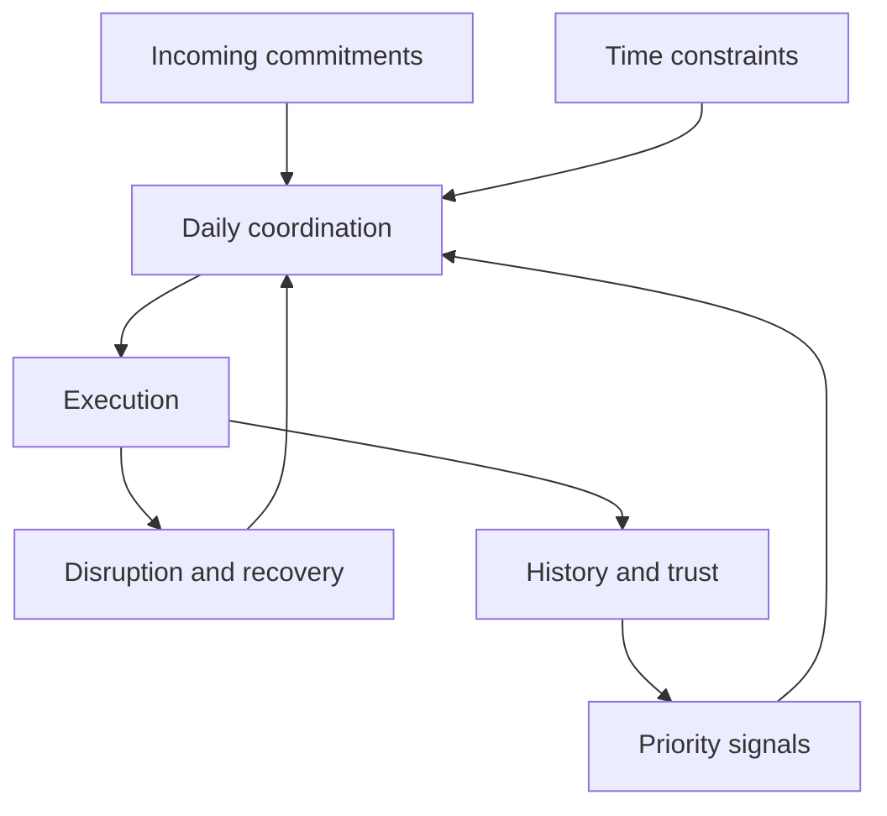

# Phase 3 — Problem Convergence
## UX Research Case Study — Daily Orchestration

> **Finalised:** 10 October 2026 (India time). **Research status:** desk research and analyst synthesis complete; primary interviews, co-creation and usability testing have not been conducted. The numbered pages are narrative sections, not a promise of printed pagination.

> **Continuity checkpoint**  
> **HMW:** How might we help self-managing knowledge workers in India turn scattered work and personal commitments into a realistic, adaptable daily plan that remains calm enough to use throughout the day?  
> **Target user:** India-based, English-speaking individual knowledge workers in a self-managed/hybrid work phase who coordinate work tasks, calendar commitments, personal routines and focus across multiple digital tools.  
> **Geography:** India-first; global evidence used where India-specific evidence is unavailable.  
> **Framework carried forward:** Cognitive Load · Time Control · Focus · Follow-through · Wellbeing · Trust & Agency.  
> **Phase 2 problem categories:** Capture Fragmentation · Priority Ambiguity · Capacity Blindness · Execution Friction · Re-planning Burden · System Sustainability.

---

## Research Integrity Note

This phase **converges** the broad problem space. It does not pretend that synthetic scenarios are participant evidence.

- No user interviews were supplied.
- No usability-study results were supplied.
- No invented participant quotes, sample sizes, conversion rates or preference percentages are used.
- Problem scores below are **analyst synthesis scores**, not participant votes.
- Public community discussions are used only as weak-to-moderate qualitative signals.
- Secondary statistics are linked to their sources.
- The product name and proposed feature design are intentionally withheld until Phase 4, in line with the case-study method's no-solution-leakage rule.

The purpose here is to decide **which problem deserves design attention first**, and why.

---

# Page 1 — From Broad Friction to One Defensible Problem

## 1.1 What Phase 2 Expanded

Phase 2 showed that the apparent problem — “people use too many productivity apps” — is too shallow.

A multi-tool setup can work well when each tool has a clear role. Likewise, a single application can still feel exhausting if it asks users to maintain lists, calendars, habits, routines, priorities and AI configuration independently.

The deeper issue is the **coordination work between commitments**:

1. capture something before it is forgotten;
2. decide whether it matters;
3. decide when it can realistically fit;
4. protect time to do it;
5. respond when the day changes;
6. preserve routines without pretending work is predictable;
7. close the day without leaving another layer of maintenance behind.

The proposed coordination job combines several transitions. Existing planners already address parts of it; how often our target users still perform this work manually remains unknown.

### Why this matters

Phase 1 established dated India focus/time context (E2), while Phase 2 examined alternative service models. Neither establishes a target-specific planning gap. The newer evidence carried here is the 2025 global WTI survey, in which **48% of employees and 52% of leaders** described work as chaotic and fragmented, alongside human–AI interaction guidance. These findings support investigating uncertainty and user agency, not preferring our proposed design.

**Interpretation:** The opportunity is not “put more features together.” It is to reduce the repeated translation between intention, available time, changing reality and action.

---

## 1.2 Candidate Problem Areas

Eight candidate problems were carried into convergence.

### A. Fragmented capture
Commitments arrive through chat, email, meetings, memory, notes and task apps. Users risk losing work or duplicating it while transferring items into a trusted system.

### B. Priority ambiguity
A large backlog preserves commitments but does not decide which few deserve attention now. Labels and priority flags can become another maintenance layer.

### C. Capacity-blind daily planning
Users can mark tasks “today” without confronting whether those tasks fit around meetings, energy, routines and realistic durations.

### D. Execution context switching
Even after planning, the user may need to move among task lists, calendar, timer, notes, chat and other apps to actually execute the work.

### E. Mid-day re-planning burden
A meeting runs over, a new urgent request arrives, energy drops, or a personal obligation appears. The user must decide what moves, what stays and what is abandoned — often by rebuilding the plan manually.

### F. Routine/work disconnection
Habits and personal routines are frequently tracked separately from work planning, so they disappear when work expands.

### G. System maintenance and feature overload
A productivity system can become a hobby: repeated tagging, rearranging, syncing, logging and configuring competes with doing the work itself.

### H. Opaque AI scheduling and loss of agency
Automation can reduce planning work, but if it moves commitments without understandable reasons, users may distrust it, undo it or stop relying on the system.

---

## 1.3 Convergence Criteria

Each candidate was scored from 1–5 on six criteria.

| Criterion | Meaning |
|---|---|
| Evidence strength | How strongly secondary evidence + public qualitative signals support the problem |
| Frequency | How often the issue plausibly occurs in a normal week/day |
| Severity | Consequence for focus, stress, follow-through or missed commitments |
| Product leverage | Whether solving it can connect several existing capability areas rather than one isolated feature |
| Differentiation potential | Whether the problem is less commoditized than basic task/calendar functionality |
| Agency fit | Whether the problem can be solved while preserving user control and avoiding opaque automation |

> **Important:** These are research-synthesis judgments. They are a transparent decision tool, **not empirical participant scores**.

---

## 1.4 Problem Scoring Matrix

| Candidate problem | Evidence | Frequency | Severity | Product leverage | Differentiation | Agency fit | Total / 30 |
|---|---:|---:|---:|---:|---:|---:|---:|
| A. Fragmented capture | 4 | 4 | 3 | 4 | 2 | 5 | **22** |
| B. Priority ambiguity | 4 | 5 | 4 | 4 | 3 | 5 | **25** |
| C. Capacity-blind daily planning | 3 | 4 | 4 | 5 | 2 | 5 | **23** |
| D. Execution context switching | 5 | 5 | 4 | 4 | 3 | 5 | **26** |
| E. Mid-day re-planning burden | 3 | 4 | 4 | 5 | 2 | 4 | **22** |
| F. Routine/work disconnection | 2 | 3 | 3 | 4 | 4 | 5 | **21** |
| G. System maintenance / feature overload | 3 | 4 | 4 | 5 | 4 | 5 | **25** |
| H. Opaque AI scheduling / loss of agency | 4 | 3 | 5 | 5 | 5 | 2 | **24** |

### What the matrix reveals

**Execution switching scores highest.** We reduced differentiation judgments for capacity planning and recovery after checking services that already provide those capabilities. The chosen direction is therefore not a statistical winner or an uncontested market gap.

We select **capacity-aware planning and recovery** as a coherent combined job to investigate: one moment concerns initial commitment; the other concerns adjustment after disruption. This is a strategic scope choice constrained by the builder's available capability areas. The narrower, controllable planning loop is more directly addressable than switching across all business applications. That feasibility constraint must not be mistaken for user evidence.

**Sensitivity check:** excluding product leverage and differentiation gives C = 16/20, E = 15/20 and D = 19/20. The current evidence does not make the selected direction win. If real users report that their main cost is locating documents, starting work, or handling mandatory meetings, we should change the scope rather than force those problems into planning.

---

## 1.5 The Chosen Problem Area

### Capacity-aware daily orchestration and re-planning

> **Users must repeatedly translate a backlog of tasks, calendar commitments, routines and changing priorities into a realistic day — then manually reconstruct that day when reality changes.**

This framing is narrower than “productivity” and sharper than “all-in-one.”

It also explains why several adjacent frustrations cluster together:

- priority ambiguity matters because not everything fits;
- calendar visibility matters because time is finite;
- routines matter because work competes with personal commitments;
- focus matters because a plan has value only if it turns into protected execution;
- AI trust matters because adaptive re-planning is useful only if the user understands and controls it;
- feature overload matters because reducing orchestration cannot require even more orchestration.

---

## 1.6 Why Other Problems Are Not the Lead Problem

### Fragmented capture — important, but commoditized
Fast capture is necessary. Inbox, quick-add and integrations are familiar patterns in mature task products. Capture becomes strategically meaningful only when captured items can be turned into a feasible day.

### Priority ambiguity — real, but incomplete
Prioritization frameworks help decide importance. They do not answer the operational question: **what fits around today's constraints, and what should move when those constraints change?**

### Execution context switching — strong evidence, but partly downstream
Reducing app switching is valuable, and the HBR evidence shows a measurable reorientation cost. But simply consolidating interfaces can reproduce complexity inside one product. The stronger design target is the decision loop that causes repeated switching and re-entry.

### Routine/work disconnection — meaningful segment opportunity, weaker evidence
The product scope makes this relevant, but the current research base does not prove it is the most painful issue for the target cohort. It should remain a supporting requirement.

### Feature overload — design constraint, not primary job
Overload explains why an integrated product can fail. It should shape solution behavior, information architecture and progressive disclosure rather than become the sole problem statement.

### Opaque AI scheduling — critical trust constraint, not the originating problem
AI does not create the need for daily orchestration; it changes how the need might be addressed. Human-AI research strongly supports keeping users informed, allowing easy dismissal/correction and making system behavior understandable. Therefore trust becomes a non-negotiable design principle for the eventual solution.

---

# Page 2 — Ecosystem Around the Chosen Problem

## 2.1 Ecosystem Map

The chosen problem does not live inside a task list. It sits at the intersection of six systems.

This is a hypothesis model, not a measured causal network.

### Ecosystem interpretation

A planning product can fail even if each individual module works correctly.

The value is produced by the **transitions**:

- inbox → decision;
- decision → time;
- time → focus;
- disruption → recovery;
- history → better future decisions.

Those transitions are where users currently perform cognitive work that software often leaves implicit.

---

## 2.2 Inputs the System Must Reconcile

| Input | What it tells the user | Failure when ignored |
|---|---|---|
| Task backlog | What could be done | Today becomes a wish list |
| Deadlines | What is time-sensitive | Urgent work appears late |
| Priority | What matters more | Easy/visible work wins |
| Calendar | What time is already committed | Plans exceed available hours |
| Duration estimate | How much space work needs | Blocks become symbolic rather than executable |
| Personal routines | What must survive alongside work | Health/personal commitments get displaced |
| Energy/context | What kind of work is feasible | Deep work scheduled in low-capacity windows |
| Interruptions | What changed | User must manually reconstruct the day |
| Completion history | What actually happened | Same unrealistic planning repeats |
| AI suggestion rationale | Why an adjustment is proposed | Automation feels arbitrary |

This does **not** imply all inputs must be mandatory. In fact, requiring complete metadata would reproduce system-maintenance burden. The design challenge is to infer or progressively request only what materially changes the plan.

---

## 2.3 Stakeholder Influence on Daily Orchestration

### Direct user
The knowledge worker owns the system, but does not control all incoming demands.

### Manager / project lead
Changes urgency, schedules meetings, creates deadlines and can invalidate a carefully planned day.

### Teammates
Introduce dependencies, reviews, messages and synchronous collaboration.

### Clients / external stakeholders
Can create high-urgency work with low scheduling predictability.

### Household / family / personal life
Creates legitimate commitments that a work-only planner may hide or de-prioritize.

### Calendar providers
Hold the most concrete representation of already-committed time.

### Messaging/email systems
Generate work but usually do not express realistic execution cost.

### AI systems
Can reduce coordination effort but add uncertainty: users need to know what changed, why, and how to reverse it.

### Device / notification layer
Can either support the current plan or continuously fracture attention.

**Convergence insight:** The user's calendar is not the same thing as the user's capacity, and the user's task list is not the same thing as the user's plan. The chosen problem exists in the gap between them.

---

## 2.4 Behavioral Tensions the Solution Must Respect

### Control vs relief
Users may want help planning but resist software that moves important commitments silently.

### Completeness vs calm
Showing everything creates transparency but also visual and cognitive overload.

### Ambition vs feasibility
A long list feels productive at planning time; an achievable list feels better at completion time. The system must help users accept trade-offs early.

### Structure vs adaptability
Rigid time blocking can fail after one disruption. Pure flexibility can become avoidance. The design must preserve enough structure to guide action while making change inexpensive.

### Work vs whole-life planning
A work-only plan may appear feasible while stealing time from routines or personal commitments. A whole-life plan can become invasive if users do not control visibility and boundaries.

### Prediction vs uncertainty
Duration estimates and AI recommendations are inherently imperfect. The product should expose uncertainty rather than present a false sense of precision.

---

# Page 3 — Pain Points, Regional Scenario and Existing-Service Gaps

## 3.1 Pain-Point Inventory

The chosen problem can be decomposed into four moments.

### Before the day: build a feasible plan
1. A “Today” list can grow without any capacity limit.
2. Meeting load is visible, but the effect on available focus time is not always explicit.
3. Tasks often lack duration estimates, making schedule feasibility hard to judge.
4. Priority markers communicate importance, not trade-offs.
5. Personal routines compete with work but may live in separate systems.
6. The user may spend too much time arranging the day before doing work.

### During execution: convert plan into attention
7. The next action may be visible in one app while the relevant context/timer/calendar is elsewhere.
8. Incoming requests can feel more urgent than pre-committed deep work.
9. A focus block ending does not automatically answer what should happen next.
10. Notifications can re-open prioritization decisions that the morning plan was supposed to close.

### When reality changes: recover cheaply
11. One delayed meeting can invalidate several later blocks.
12. Moving one task creates downstream decisions about what to defer.
13. Users may rebuild the calendar manually rather than reason from priorities and capacity.
14. Auto-scheduling can feel efficient but surprising if it changes commitments without clear rationale.
15. Re-planning itself becomes a tax, so users eventually stop maintaining the plan.

### At the end of the day: learn without guilt
16. Incomplete tasks can roll forward indefinitely without a deliberate decision.
17. A system may reward streaks/volume while hiding whether the day was realistically scoped.
18. Users can interpret plan failure as personal failure even when the schedule was structurally impossible.
19. History can become analytics noise unless it changes future planning behavior.
20. An elaborate shutdown routine can become yet another obligation.

---

## 3.2 India-First Scenario

### What the regional evidence can support
The dated India surveys cited in Phase 1 provide context for focus, time/energy and workplace AI use. They do not measure our particular segment's daily-planning effort or acceptable delegation. Employer integration restrictions, language/device preferences, subscription budgets and cross-time-zone work need direct investigation; no national stereotype is used as a finding.

### Regional design implication

For this working audience, investigate whether daily coordination could become **more realistic and less effortful**. The frequency, preferred device and acceptable assistance level are still hypotheses.

Research should therefore establish:

- how much effort capture and clarification require;
- whether task priority is considered alongside actual time;
- which changes make a plan unusable;
- which personal/work boundaries must be preserved;
- what users need to understand before delegating a decision;
- how much effort they spend maintaining integrations or plans.

---

## 3.3 Existing-Service Archetypes

Official documentation shows that users can obtain many component capabilities elsewhere; their effectiveness for this cohort remains to be tested.

### Archetype A — broad integrated productivity app
an integrated organiser publicly offers task management, calendars, habit tracking, Pomodoro/focus, Eisenhower-style organization and statistics.

**Strength:** Many needs can live in one product.  
**Risk:** Breadth alone does not guarantee that the user knows what realistically fits today or how to recover after disruption. Public community discussions also show that some users experience feature complexity or system-maintenance burden, though those discussions are not representative evidence.

### Archetype B — ritualized daily planner
a guided daily planner emphasizes guided daily planning, shutdown rituals and timeboxing.

**Strength:** Makes planning a deliberate behavior rather than a passive task list.  
**Risk:** The planning ritual itself must remain lightweight; otherwise users can spend meaningful time maintaining the system.

### Archetype C — automatic scheduler
an automatic scheduler markets an AI calendar that dynamically schedules and re-plans tasks around availability, priorities and deadlines.

**Strength:** Directly attacks the scheduling/re-planning burden.  
**Risk:** The more a system changes a plan automatically, the more important explainability, correction and user agency become. Human-AI interaction research recommends making it easy to invoke or dismiss AI behavior, correct wrong behavior and understand why the system acted.

### Archetype D — consolidation / command center
a consolidated planning workspace combines a universal inbox, calendar, daily rituals, focus tools, time blocking and AI-oriented workflows.

**Strength:** Reduces movement between systems and supports orchestration.  
**Risk:** Consolidation can still become another layer users must keep synchronized unless imports, decisions and planning states are legible and low maintenance.

---

## 3.4 What Is Still Unsolved

The category offers many relevant features. Whether a target-specific gap remains in **decision effort and recovery** is unproven. Calmness is a design hypothesis, not a claim that competitors are deficient.

A defensible opportunity sits between two extremes:

| Delegation model to investigate | Possible benefit | Possible cost |
|---|---|---|
| Fully manual | Direct control | Repeated planning effort |
| Reviewed recommendations | Help with trade-offs | Review and correction effort |
| Automatic adjustment | Less manual scheduling | Surprise or supervision effort |

No model is assumed to win before testing.

The design thesis is therefore:

> **Software should do more of the coordination arithmetic while the user keeps the consequential judgment.**

That thesis remains a hypothesis until tested with real users.

---

## 3.5 Setbacks of the Current “Tool Stack” Service Model

The closest existing service is not one application; it is the user's current assemblage of task list + calendar + habit/focus tools + communication + AI.

### Setback 1 — synchronization is partly cognitive
Even when data sync exists, meaning may not. A task can exist in a list and a calendar, while the user still decides whether it deserves today’s limited attention.

### Setback 2 — time is represented differently in each tool
Tasks are often binary objects; calendars are time containers; habits are recurrence rules; AI chats are conversational context. The user bridges these representations manually.

### Setback 3 — disruption has no shared recovery logic
When a meeting moves, an urgent request arrives or a task takes longer than expected, each application remains locally correct while the overall day becomes globally wrong.

### Setback 4 — more automation can move the tax rather than remove it
If users must constantly verify what AI changed, resolve collisions or reverse unexpected rescheduling, planning effort returns as supervision effort.

### Setback 5 — breadth creates an abandonment risk
A product that centralizes tasks, habits, focus, notes, calendar and AI can accidentally expose all modules at once. The result may be a single application with the cognitive footprint of several applications.

---

# Page 4 — Impact, Viability and the Refined Need

## 4.1 Impact Ripple

### Level 1 — Individual clarity
A feasible day reduces the number of decisions the user must repeatedly reopen.

### Level 2 — Focus quality
A clearer next action and protected time can reduce unnecessary switching between planning and execution states.

### Level 3 — Follow-through
Visible capacity forces earlier trade-offs: defer, shorten, delegate, decline or schedule.

### Level 4 — Wellbeing / self-perception
A realistic plan can shift the end-of-day question from “Why did I fail my list?” to “Did I make the right trade-offs with the time I actually had?” This is a design hypothesis, not a measured outcome.

### Level 5 — Team / organizational behavior
Individuals who have a more realistic view of capacity may surface conflicts earlier rather than discovering them at deadline time. Team-level impact requires separate validation because this project currently targets an individual user.

### Level 6 — Market opportunity
The broader category is economically meaningful. Grand View Research estimates the global productivity management software market at **$59.9B in 2023**, rising to **$149.7B by 2030**, with Asia Pacific projected to grow at 15.8% CAGR from 2024–2030. Its AI productivity tools report estimates **$11.1B in 2025**, **$14.1B in 2026**, and **$36.4B by 2033**. These are publisher estimates and forecasts for broad, overlapping categories, not additive markets, an India-first addressable market, or proof of product demand. The AI report also contains an inconsistent million/billion label in image text; its prose says billions, so its figures should not be used for an investment decision without checking the underlying report.

---

## 4.2 Business Viability Lens

A useful problem is not automatically a viable product wedge. The chosen problem has five advantages.

### 1. High-frequency behavior
Daily planning offers a plausible repeated-use occasion. A diary must establish whether recovery happens often enough, and matters enough, to sustain use.

### 2. Multi-module leverage
The problem naturally connects capture, priorities, calendar, routines, focus and AI rather than depending on one isolated feature.

### 3. Clear observable outcome
Unlike generic “be more productive” promises, the product can test concrete behaviors:

- time to create a feasible day;
- number of commitments intentionally deferred before overbooking;
- time/steps needed to recover after an injected disruption;
- number of manual cross-tool transfers;
- task-to-focus-block conversion;
- user's perceived clarity/control.

### 4. Monetizable value without enterprise dependency
An individual could experience the benefit directly, but subscription willingness, employer restrictions and migration cost are unknown. A repeated-use pilot and payment test are required before describing this as monetisable.

### 5. Expansion path
Once the daily orchestration loop works, adjacent value can expand into team capacity, cross-device planning, richer integrations and personalized AI — without making those dependencies necessary for the initial wedge.

---

## 4.3 Risk Register

| Risk | Why it matters | Research/design response |
|---|---|---|
| Users do not want to estimate task duration | Capacity logic becomes weak | Use defaults/inference; ask only when uncertainty materially affects the day |
| AI re-planning feels intrusive | Trust collapses | Suggestion-first changes, rationale, preview, undo/dismiss |
| “All-in-one” becomes overwhelming | Integration creates new cognitive load | Progressive disclosure; Today-first surface; modules appear when context requires |
| Calendar becomes the system of record for everything | Flexible work gets falsely rigid | Support unscheduled priorities and flexible blocks |
| Personal routines mixed with work feel invasive | Privacy/boundary concerns | User-controlled visibility and separate categories/context |
| Planning ritual takes too long | Product becomes another chore | Hard target for short plan setup; test time-on-task |
| User ignores the plan after first disruption | Core loop fails | Recovery experience must be as strong as morning planning |
| Suggestions optimize efficiency over meaning | “Productivity” becomes mechanical | Preserve explicit user priorities and allow intentional empty space |

---

## 4.4 Refined Sub-HMW Questions

The original HMW remains the continuity anchor. Phase 3 decomposes it into three designable questions.

### Sub-HMW 1 — See capacity before overcommitting
> **How might we make the trade-off between priorities and available time visible before the user commits to an unrealistic day?**

### Sub-HMW 2 — Recover without rebuilding
> **How might we help users recover from interruptions or overruns without manually reconstructing the rest of their day?**

### Sub-HMW 3 — Use AI without surrendering agency
> **How might AI recommend what to move, defer or protect while making its reasoning understandable and every change easy to accept, edit or reject?**

These are not three independent products. They describe one loop: **plan → execute → adapt**.

---

## 4.5 Formal Need Statement

> **Self-managing knowledge workers in India need a low-friction, capacity-aware way to translate priorities and personal routines into an adjustable daily plan, with visible trade-offs when conditions change, so they can reduce planning overhead and protect focus while preserving agency over what gets done, moved or dropped.**

### Why each phrase is present

| Phrase | Research reason |
|---|---|
| self-managing knowledge workers in India | retains target and geography |
| low-friction | addresses system-maintenance/feature-overload risk |
| capacity-aware | converged problem: backlog ≠ feasible day |
| priorities and personal routines | whole-day commitments, not work tasks alone |
| adjustable daily plan | acknowledges disruption as normal |
| visible trade-offs | avoids hidden consequences / false precision |
| reduce planning overhead | addresses coordination tax |
| protect focus | supported by India/global focus evidence |
| preserving agency | human-AI trust constraint |
| done, moved or dropped | makes intentional deferral a valid outcome |

---

## 4.6 What Phase 4 Is Allowed to Solve

Phase 4 may now introduce the product, but it must stay inside these boundaries.

### Must do
- connect tasks to actual available time;
- expose overload before the day is committed;
- make the next action clear without showing the whole system at once;
- make disruption recovery cheaper than manual re-planning;
- preserve explicit user control over meaningful schedule changes;
- explain AI recommendations;
- integrate routines/focus without turning them into extra bookkeeping.

### Must not assume
- that users want every task auto-scheduled;
- that users will provide perfect duration estimates;
- that AI suggestions are trusted by default;
- that a unified interface alone solves fragmentation;
- that more streaks, dashboards or analytics create value;
- that personal and work calendars can be merged without boundary controls.

---

## 4.7 Evidence Required to Validate the Problem Direction

The next research pass should recruit 8–12 target users and validate the converged need directly.

### Test 1 — Current-state reconstruction
Ask each participant to reconstruct yesterday from calendar, task tools and messages. Measure where prioritization/re-planning decisions happened.

### Test 2 — Morning-plan observation
Observe the participant planning a real day. Record tools opened, time taken, metadata added, uncertainty points and trade-offs.

### Test 3 — Disruption injection
During a concept test, introduce a 45-minute meeting overrun or urgent 90-minute request. Observe what the participant changes and what information they need.

### Test 4 — Delegation boundary
Investigate which decisions users would delegate, how they want to inspect consequences, and what they must retain. The designed manual, recommendation and automatic variants belong to Phase 4. Preference alone is insufficient; observe comprehension and correction.

### Test 5 — One-week diary
Capture the first moment each day where the original plan becomes inaccurate. This will reveal whether the chosen problem is truly daily/high-frequency or merely salient in interviews.

---

## Evidence Confidence Map

| Claim | Confidence | Basis |
|---|---:|---|
| Knowledge work is interruption-heavy and fragmented | High | Microsoft global work-pattern evidence |
| India-based workers report limited focus/time-energy | High | Microsoft India Work Trend Index |
| App switching has measurable reorientation cost | Medium-High | HBR observational study; non-India sample |
| Capacity-aware planning and re-planning is the selected research hypothesis | Low-Medium | Analyst synthesis; existing competitors address the same job |
| Integrated breadth alone is not differentiation | High | Direct competitor feature comparison |
| Some posters describe feature overload / maintenance | Low | Public discussion; nonrepresentative and partly promotional |
| Suggestion-first AI will outperform auto-scheduling for this audience | Low-Medium | Human-AI principles + hypothesis; must be tested |
| Integrating personal routines will improve follow-through | Low-Medium | Product logic + Phase 2 synthesis; insufficient primary evidence |

---

## Self-Audit Scores

Editorial judgments, not measured quality scores. **AI-Likeness: lower is better; all other dimensions: higher is better.**

| Dimension | Score | Justification |
|---|---:|---|
| AI-Likeness | 3/10 | Specific trade-offs, rejected alternatives, confidence markers and explicit missing evidence reduce generic case-study language. |
| Convergence Rigor | 8/10 | Eight candidates, six criteria and an explicit choice make the narrowing traceable; score is limited because there was no participant/team voting. |
| Theme–Ecosystem Depth | 9/10 | Chosen problem is mapped across inputs, constraints, execution, recovery, stakeholders, market archetypes and trust. |
| Refinement Sharpness | 9/10 | Ends with one need statement, three sub-HMWs, design boundaries and measurable validation questions. |

**Weakest dimension:** Convergence Rigor. Scores are analyst judgments; the selected scope does not score highest after competitor overlap is acknowledged. User evidence must establish whether this job is more valuable than capture, starting work, switching or maintenance.

---

## Project State — Phase 3 Complete

- **Phase completed:** 3 — Problem Convergence
- **Original HMW:** How might we help self-managing knowledge workers in India turn scattered work and personal commitments into a realistic, adaptable daily plan that remains calm enough to use throughout the day?
- **Target user:** India-based, English-speaking individual knowledge workers in a self-managed/hybrid work phase who coordinate work tasks, calendar commitments, personal routines and focus across multiple digital tools.
- **Geography:** India-first.
- **Chosen problem:** Capacity-aware daily orchestration and re-planning.
- **Core tension:** Backlog ≠ capacity; calendar ≠ priority; automation ≠ trust.
- **Formal need statement:** Self-managing knowledge workers in India need a low-friction, capacity-aware way to translate priorities and personal routines into an adjustable daily plan, with visible trade-offs when conditions change, so they can reduce planning overhead and protect focus while preserving agency over what gets done, moved or dropped.
- **Sub-HMWs:** capacity visibility; disruption recovery; explainable user-controlled AI.
- **Qualities carried to Phase 4:** low effort, feasible commitments, understandable trade-offs, retained agency, adaptable recovery and clear attention.
- **Evidence limitation:** No primary interviews or real concept tests are available yet; the chosen problem remains a strong research hypothesis rather than validated product-market evidence.

---

## Sources

### Method + product context
1. UX Case Study Writer method: [Source](<https://github.com/divysharma7/ux-case-study-writer>)
2. Builder-supplied product README (held as a Phase 4 feasibility constraint; solution details intentionally omitted from Phases 1–3).

### Work / behavior research
3. Microsoft Work Trend Index 2023, global: [Source](<https://www.microsoft.com/en-us/worklab/work-trend-index/will-ai-fix-work>)
4. Microsoft India Work Trend Index 2023: [Source](<https://news.microsoft.com/en-in/microsoft-work-trend-index-2023-releases-new-insights-on-how-ai-will-change-the-way-we-work-in-india/>)
5. Microsoft / LinkedIn India Work Trend Index 2024: [Source](<https://news.microsoft.com/en-in/92-of-indian-knowledge-workers-use-ai-in-the-workplace-finds-microsoft-and-linkedin-2024-work-trend-index/>)
6. Microsoft, “Breaking down the infinite workday,” 2025: [Source](<https://www.microsoft.com/en-us/worklab/work-trend-index/breaking-down-infinite-workday>)
7. Harvard Business Review, “How Much Time and Energy Do We Waste Toggling Between Applications?”: [Source](<https://hbr.org/2022/08/how-much-time-and-energy-do-we-waste-toggling-between-applications>)
8. Leroy, S. (2009), attention residue: [Source](<https://doi.org/10.1016/j.obhdp.2009.04.002>)
9. Microsoft Research, Guidelines for Human-AI Interaction: [Source](<https://www.microsoft.com/en-us/research/articles/guidelines-for-human-ai-interaction-eighteen-best-practices-for-human-centered-ai-design/>)

### Market context
10. Grand View Research, Productivity Management Software Market: [Source](<https://www.grandviewresearch.com/industry-analysis/productivity-management-software-market>)
11. Grand View Research, AI Productivity Tools Market: [Source](<https://www.grandviewresearch.com/industry-analysis/ai-productivity-tools-market-report>)

### Competitor / service context
12. TickTick features: [Source](<https://ticktick.com/features>)
13. Sunsama daily planning / shutdown: [Source](<https://www.sunsama.com/features/daily-planning-and-shutdown>)
14. Sunsama timeboxing: [Source](<https://www.sunsama.com/features/timeboxing>)
15. Motion AI Calendar: [Source](<https://www.usemotion.com/features/ai-calendar>)
16. Akiflow features: [Source](<https://akiflow.com/features>)
17. Todoist calendar integration: [Source](<https://www.todoist.com/help/articles/use-the-calendar-integration-rCqwLCt3G>)

### Public qualitative signals (directional only)
18. Maintenance / sync-tax discussion: [Source](<https://www.reddit.com/r/ProductivityApps/comments/1u0bi0x/ive_tried_multiple_productivity_and_habittracking/>)
19. Fewer-apps discussion: [Source](<https://www.reddit.com/r/ProductivityApps/comments/1sxzf5h/unpopular_opinion_most_people_need_fewer/>)
