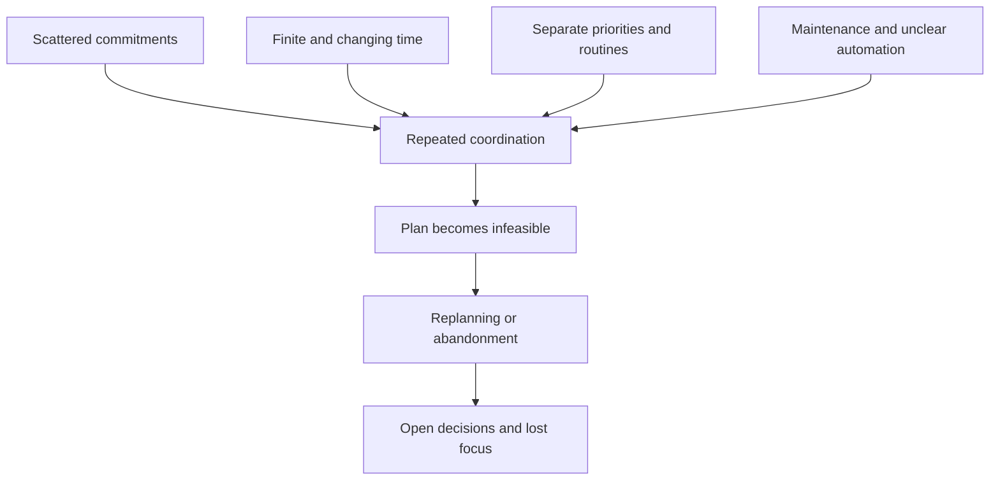
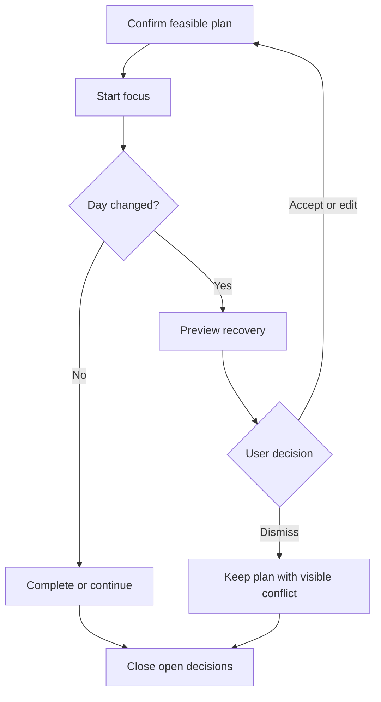

# Phase 4 — Solution Delivery and Validation Plan
## Life OS UX Research Case Study

> **Finalised:** 10 October 2026 (India time). **Research status:** desk research and analyst synthesis complete; primary interviews, co-creation and usability testing have not been conducted. The numbered pages are narrative sections, not a promise of printed pagination.

> **Continuity checkpoint**  
> **HMW:** How might we help self-managing knowledge workers in India turn scattered work and personal commitments into a realistic, adaptable daily plan that remains calm enough to use throughout the day?  
> **Target user:** India-based, English-speaking individual knowledge workers in a self-managed/hybrid work phase who coordinate work tasks, calendar commitments, personal routines and focus across multiple digital tools.  
> **Geography:** India-first.  
> **Chosen problem:** Capacity-aware daily orchestration and re-planning.  
> **Formal need statement:** **Self-managing knowledge workers in India need a low-friction, capacity-aware way to translate priorities and personal routines into an adjustable daily plan, with visible trade-offs when conditions change, so they can reduce planning overhead and protect focus while preserving agency over what gets done, moved or dropped.**

---

## Research Integrity Note

Phase 4 is where the existing product may finally enter the case study.

The product is **Life OS — Your Daily Operating System**, described in the supplied README as a unified productivity platform combining tasks, habits, calendar planning, focus sessions, workflows and an AI assistant. The README also documents existing capabilities including Quick Add, Inbox, subtasks, priorities, Today / Next 7 Days, a calendar with Google Calendar two-way sync, time blocking and capacity warnings, habits, morning/evening rituals, Pomodoro/stopwatch focus, AI chat, an AI Brief and smart task suggestions.

This phase distinguishes between:

- **README-documented capabilities**, asserted by the builder and not independently tested here;
- **recommended UX orchestration** that connects those capabilities around the converged research problem;
- **future hypotheses** that require user testing.

No usability-study result, preference percentage or participant quote is fabricated. Validation thresholds below are **targets**, not observed results.

---

# Page 1 — From Research Need to Product Direction

## 1.1 Research Background

The research began with a broad question about fragmented productivity systems.

It narrowed through four observations:

1. External studies describe fragmented work and attention costs in their studied populations.
2. Indian workers report substantial time/energy and focus constraints.
3. Current products already combine these capabilities; some also project capacity, lock task blocks and adapt schedules. Neither breadth nor capacity awareness is unique.
4. The selected job to investigate is converting **what matters** into **what fits**, then recovering when conditions change. Its relative importance and remaining unmet demand are unvalidated.

The product opportunity is therefore not:

> Put every productivity feature in one app.

It is:

> **Create a calm daily orchestration layer that continuously reconciles commitments, time and change without taking judgment away from the user.**

---

## 1.2 Cause → Effect Tree

The causal links are a synthesis model, not measured causal effects. The five macro conditions carried from earlier phases are scattered capture, finite time, competing priorities, disruption and maintenance/trust. The focused branch is repeated coordination: unknown durations, unclear commitment states, no explicit trade-off, stale plans, repeated edits and opaque delegation.

The solution should target the **coordination problem**, not merely decorate the downstream symptoms.

---

## 1.3 Hero Evidence

Two pieces of evidence make the problem concrete:

- Microsoft reported that **78% of Indian workers said they lacked uninterrupted focus during the workday** in its 2023 India Work Trend Index.
- A Harvard Business Review summary of an observational study across 137 users found roughly **1,200 application/website toggles per day**, with just under **four hours per week** spent reorienting after toggles.

Neither statistic proves that Life OS solves the issue. They establish that focus fragmentation and coordination overhead are large enough to justify focused testing.

---

## 1.4 Need Statement — Repeated Verbatim

> **Self-managing knowledge workers in India need a low-friction, capacity-aware way to translate priorities and personal routines into an adjustable daily plan, with visible trade-offs when conditions change, so they can reduce planning overhead and protect focus while preserving agency over what gets done, moved or dropped.**

Every proposed experience below must trace back to this sentence.

---

## 1.5 How-To Questions for Ideation

1. How could the system show “what fits” before a user overloads Today?
2. How could meeting load reduce visible daily capacity automatically without hiding the calculation?
3. How could tasks remain quick to capture even when duration or priority is unknown?
4. How could the system suggest a realistic top three without pretending it knows the user's values better than the user?
5. How could personal routines reserve meaningful space without mixing private and professional contexts unnecessarily?
6. How could users convert a task into a focus block in one action?
7. How could a late meeting trigger a lightweight recovery flow instead of forcing calendar reconstruction?
8. How could the user understand which commitment an AI recommendation displaced and why?
9. How could the product make “defer” feel like an intentional planning decision rather than failure?
10. How could AI assistance be useful when the user has not added perfect durations or metadata?
11. How could the system keep the Today surface calm even though the underlying product has many modules?
12. How could end-of-day reflection improve tomorrow without turning into another dashboard ritual?
13. How could the system learn from overruns while allowing the user to correct bad inferences?
14. How could the user recover when they ignore the plan for several hours?
15. How could the product distinguish a flexible intention from a hard commitment?
16. How could users see the consequence of accepting a new task before accepting it into today?

---

## 1.6 Current → Challenge → Vision

| Current reality | Challenge | Product vision |
|---|---|---|
| Tasks exist as a backlog | Backlog is mistaken for capacity | Today shows a feasible commitment set |
| Calendar shows fixed time | Free space is not automatically meaningful focus capacity | Available focus capacity becomes visible |
| Habits/routines live separately | Work expansion silently displaces personal commitments | Routines participate in planning without dominating it |
| Focus timer is a separate mode | Starting focus can require another planning decision | Planned task → focus session becomes one continuous action |
| Disruption invalidates time blocks | User must manually decide what moves | Recovery flow proposes trade-offs, user confirms |
| AI can generate suggestions | Opaque changes can reduce trust | Recommendations expose reason, consequence and undo |
| Many product modules exist | Breadth can create cognitive overhead | Today becomes the calm front door; depth is progressive |

---

## 1.7 Concept Strategy

### Life OS should behave like a *daily operating layer*, not a feature directory.

The README documents relevant ingredients; their reliability has not been audited. The recommended change is primarily **orchestration and hierarchy**:

The proposed daily loop is **capture → clarify → see capacity → commit → focus → adapt → close**.

The key design principle is:

> **Move complexity behind the daily loop rather than asking the user to navigate complexity to build the loop.**

---

## 1.8 Co-Creation / Validation Status

### What has actually happened

No real co-creation workshop or moderated usability test was conducted or supplied for this case study.

### What was simulated

The earlier phases used synthetic scenarios to pressure-test the logic. Those scenarios are hypothesis generators only and must not be presented as participant validation.

### What should happen next

A focused concept study with **8–12 target users** should test three critical behaviors:

1. **Morning feasibility:** Can users understand and commit to a realistic day quickly?
2. **Disruption recovery:** Can they recover after an injected schedule disruption without reconstructing the whole plan?
3. **AI agency:** Do they understand why a change is suggested, what it affects and how to reject/correct it?

### Research constraints and resolved drafting issues

- Actual user sessions and outcome measurements are absent; desk research cannot substitute for them.
- The README documents components but not end-to-end recovery behaviour, calendar error handling or AI policies.
- Competitors already address this job; the claim has been narrowed from a market gap to an experience hypothesis.
- Some community comments are promotional; they are research leads, not validation.

These are actual limits of the material, not invented stories about recruiting participants or conducting workshops. The runnable study specification and proposed thresholds are in Section 4.6.

**Visual elements to design — Page 1:** top-down cause tree; dated India focus statistic beside it; unchanged need-statement card; ideation questions grouped into feasibility, recovery, privacy/agency and attention; a clearly labelled “not yet tested” status card. Do not create approval-percentage graphics.

---

# Page 2 — The Solution: Life OS as a Calm Daily Orchestrator

## 2.1 Product Concept

**Life OS** is a personal productivity system that already combines tasks, planning/calendar, habits, focus, workflows and AI.

The research reframes its value proposition:

### Existing broad proposition
> One place for tasks, habits, calendar, focus, workflows and AI.

### Research-narrowed proposition
> **Turn everything competing for your day into one realistic plan — then help you adapt it without losing focus or control.**

The distinction matters. The first describes components. The second describes the job the components perform together.

---

## 2.2 Primary Stakeholders

### Primary: self-managing knowledge worker
Owns the plan and decides the final trade-offs.

### Secondary: teammates / manager / clients
Create meetings, requests, dependencies and deadline changes that alter capacity.

### Personal-life stakeholders
Family, health and routines create legitimate commitments that should not be treated as leftover time.

### Connected services
Google Calendar and future integrations supply external commitments and events.

### AI layer
Acts as a planning assistant, not the decision owner.

---

## 2.3 Five Core Experience Pillars

### Feature 1 — **Calm Today Command Center**

**Existing product foundations from the README**
- Today view
- Next 7 Days
- AI Brief dashboard widget
- quick stats
- priorities / due dates
- capacity warnings

**Recommended orchestration**

Today should answer four questions before anything else:

1. What is fixed?
2. What is most important?
3. What realistically fits?
4. What should I do next?

#### Proposed UI behavior

**Constructed budget example — design arithmetic, not user data**

| Today budget | Minutes |
|---|---:|
| User-declared planning window | 540 |
| Fixed busy commitments | −190 |
| Protected routines not already represented as busy | −45 |
| Breaks | −30 |
| User-selected transition / uncertainty allowance | −90 |
| Available task capacity | **185** |
| Research synthesis + launch review + client notes | 90 + 45 + 35 = **170** |
| Capacity remaining | **15** |

These values show the arithmetic only; an actual feasible plan also needs compatible contiguous slots, deadlines and user-approved splitting.

If the user adds another 60-minute task, the system should not just accept it silently into Today. It should make the trade-off visible:

> “This puts your plan ~45 min over available focus capacity. Add anyway, shorten something, or move one item?”

**Mechanic → emotional outcome**

Capacity visibility → fewer hidden trade-offs → stronger sense of control.

---

### Feature 2 — **Universal Capture, Progressive Clarification**

**Existing product foundations**
- Inbox
- Quick Add from any screen
- global composer
- command palette
- subtasks
- priorities, tags and due dates
- lists / folders / workflows

**Recommended orchestration**

Capture must stay fast. Do not force full metadata at the moment of thought.

| Capture / clarify stage | Proposed interaction |
|---|---|
| Capture | Save “Prepare quarterly review” without required scheduling fields |
| Clarify deadline | Ask only if a due date changes the decision |
| Clarify effort | Optional 15 / 30 / 60 / 90+ minute range, or “not sure” |
| Commit | Ask whether this belongs in today's plan |

Duration is useful for capacity reasoning, but mandatory duration entry would create friction. The system can use defaults, learn from history and surface uncertainty when it matters.

#### Decision rule

> Ask for metadata **only when the answer changes the plan**.

**Mechanic → emotional outcome**

Fast capture + selective clarification → confidence that nothing is lost without turning capture into administration.

---

### Feature 3 — **Capacity-Aware Calendar Planning**

**Existing product foundations**
- full calendar / time-grid visualization
- Google Calendar two-way sync
- time blocking
- capacity warnings
- Today / Next 7 Days

**Recommended orchestration**

Calendar integration should do more than show events next to tasks. It should translate events into **remaining executable capacity**.

#### Planning states

- **Fixed:** meetings / appointments / non-movable commitments
- **Protected:** locked task blocks or personal routines. Locked tasks stay in task demand; routine busy time is counted separately only when it is not a task representation.
- **Flexible:** tasks that can move within a window
- **Unscheduled:** important work not yet given time

This prevents every task from becoming an artificial hard calendar appointment.

#### Capacity calculation and uncertainty contract

Let **W** be the union of the user's planning intervals, clipped to the remaining day. Let **B** be the union of unavailable intervals inside W: fixed busy events, locked routines, breaks and explicitly reserved buffers. Overlapping intervals count once.

**C = duration(W \ B)** is available task time. **L = sum of remaining durations of selected task commitments** is planned task demand. Display **L − C** as overload when positive. Already scheduled task blocks belong to L; they must not also be removed from C, or their time would count twice. If such a block appears as a synced calendar event, recognise the task link before classifying it.

| Condition | Proposed behaviour |
|---|---|
| Event lies partly outside W | Count only the overlap |
| Meetings overlap | Count their union; show the conflict separately |
| Routine already appears as a busy calendar event | Link it; subtract once |
| Important task has unknown duration | Show an editable range and “capacity uncertain”; do not claim an exact feasible total |
| Free total exists only in small gaps | Check minimum block size; positive remaining minutes do not guarantee placement |
| Due date is today | Treat the deadline as a constraint, not evidence the item fits |
| Calendar is disconnected or stale | Label capacity as provisional; show freshness and an explicit manual alternative |
| A task overruns | Recompute remaining duration, not its original estimate plus elapsed work |
| Multiple planning windows / cross-midnight work | Use the user's planning-day boundary and local timezone; clip the next day's commitments correctly |

The 90-minute allowance in the example is a constructed input, not a recommended universal reserve. No inferred energy score is required: a user may declare unavailable or low-capacity windows without explaining personal circumstances.

**Initial calculation:** 540 − 190 − 45 − 30 − 90 = 185; 185 − 170 = 15 minutes remaining. Adding a 60-minute item creates **45 minutes of overload**. This does not imply the software can manufacture that missing time.

**Mechanic → emotional outcome**

Calendar-aware feasibility → reduced overcommitment → realistic confidence instead of aspirational planning.

---

### Feature 4 — **Focus Bridge: Plan → Do**

**Existing product foundations**
- Pomodoro timer
- stopwatch mode
- link focus sessions to tasks or habits
- breathing ring
- session history

**Recommended orchestration**

The transition from “planned” to “doing” should require almost no new decision.

Example interaction:

| Plan-to-focus example | Proposed state |
|---|---|
| Planned work | 09:30–11:00 research synthesis |
| Start action | Start focus from that task |
| Focus context | Task title, duration, related notes/subtasks |
| Available controls | Pause, complete, needs more time |

At session end, the product should ask a decision-oriented question rather than just record minutes:

- Completed
- Continue 15m
- Needs another block
- Blocked

That response can update the rest of the day.

**Mechanic → emotional outcome**

One-action entry into focus → less planning/execution switching → greater momentum.

---

### Feature 5 — **Adaptive Rituals + Explainable AI Co-Pilot**

**Existing product foundations**
- Morning Plan
- Evening Shutdown
- AI chat with conversation history
- AI Brief
- smart task suggestions and context awareness
- memories system
- MCP integration support

**Recommended orchestration**

AI should first operate as a **suggestion layer**, especially for schedule changes.

#### Morning

> “You have 3h 05m of open focus capacity and 4h 20m of tasks marked Today. The launch review is due first. Want a feasible version of the day?”

#### Mid-day disruption

In the budget example, suppose a meeting consumes 45 additional usable minutes, after overlaps and retained buffers are accounted for.

Instead of silently moving tasks:

| Recovery preview — constructed example | Consequence |
|---|---|
| Trigger | Available task capacity falls from 185 to 140 minutes |
| Current demand | 170 minutes; **30 minutes over capacity** |
| Proposed change | Defer the 35-minute client-notes commitment, assumed to have no deadline today |
| Preserved | Synthesis, launch review and protected routine |
| Result | Demand becomes 135 minutes; 5 minutes remain, subject to a valid placement |
| User controls | Review, edit, accept or dismiss; undo after acceptance |

No specific tomorrow slot is promised until its availability has been checked. If no valid placement remains, show the conflict rather than labelling the revised plan feasible.

#### Trust requirements

Human-AI design guidance supports:

- making it clear why the system acted;
- easy dismissal;
- easy correction;
- support when the system is uncertain;
- preserving user control.

Therefore a Life OS recommendation should always expose:

1. **Trigger** — what changed?
2. **Reason** — why this recommendation?
3. **Consequence** — what moves or gets dropped?
4. **Control** — accept, edit, reject, undo.

#### Evening

The Evening Shutdown should not become a guilt report. It should close open decisions:

- What was intentionally completed?
- What needs another block?
- What should be deferred or dropped?
- Did the day run materially over/under estimated capacity?

Only insights that can improve tomorrow should surface.

**Mechanic → emotional outcome**

Explainable suggestions + easy override → useful automation without surrendering agency.

---

## 2.4 What Should Stay in the Background

Life OS has many existing capabilities: nested lists, folders, Kanban boards, workflows, Eisenhower Matrix, habit gallery, memories, chat, rich text and more.

These are valuable **depth**, but they should not compete with the daily orchestration loop on first load.

### Progressive-disclosure rule

> The user should see the complexity required for the **current decision**, not the complexity of the entire product.

This protects the “calm” promise while keeping power features available.

---

## 2.5 Information Architecture Recommendation

A research-aligned primary navigation could prioritize user jobs rather than every internal feature.

| Navigation | User question |
|---|---|
| Today | What fits, and what should I do now? |
| Inbox | What have I captured but not decided? |
| Plan | How do commitments fit across the next week? |
| Focus | How do I execute the current block? |
| Routines | Which recurring commitments do I want to protect? |
| Workspaces | Where are detailed lists, boards and workflows? |
| Assistant | Where do I ask for planning help or manage context? |

This is a recommendation, not a claim about the current UI.

The important hierarchy is **Today first**, because the research wedge is a daily coordination job rather than navigation across feature categories.

---

**Visual elements to design — Page 2:** a two-column Today surface showing task choices beside time constraints; five feature cards with small line icons (day summary, inbox, capacity gauge, task-to-focus link, recovery preview); side-by-side feasible, overloaded and uncertain states. The colours should distinguish states with text and symbols as well as colour.

---

# Page 3 — End-to-End Service Flow + UX Rules

## 3.1 The 12-Step Daily Orchestration Flow

### Step 1 — Connect context
During onboarding, the user sets working hours, optional personal boundaries, planning preferences and connects Google Calendar if desired.

**Design rule:** explain what data is used and let users skip optional inputs.

---

### Step 2 — Capture continuously
User adds tasks through Quick Add / command palette / Inbox without needing to fully plan them.

**Design rule:** capture should be cheaper than remembering.

---

### Step 3 — Clarify the Inbox
At a natural planning moment, undecided items receive only the metadata needed for scheduling: urgency/deadline, rough duration and whether the item belongs in the near-term plan.

**Design rule:** avoid mandatory taxonomy.

---

### Step 4 — Start Morning Plan
The system pulls together:

- fixed calendar commitments;
- due / important tasks;
- routines;
- unfinished work from yesterday;
- available focus capacity.

**Design rule:** the first view is a decision summary, not a dashboard buffet.

---

### Step 5 — Surface overload before commitment
If the intended day exceeds realistic capacity, the system shows the gap before the user confirms it.

**Design rule:** “over capacity by 75 min” is more actionable than a red warning icon alone.

---

### Step 6 — Choose / confirm the day
The user accepts, removes, shortens or defers commitments.

**Design rule:** deferral is a valid outcome, not a failure state.

---

### Step 7 — Place focus blocks
Flexible work is time-blocked around fixed events. The user can keep some work unscheduled if they prefer looser planning.

**Design rule:** not every task requires a calendar event.

---

### Step 8 — Start focus directly from the plan
A planned item launches the linked timer/stopwatch and task context.

**Design rule:** planning should collapse into action.

---

### Step 9 — Record execution state, not just time
At the end of the block the user can mark complete, blocked, needs-more-time or continue.

**Design rule:** execution feedback should inform the remaining plan.

---

### Step 10 — Detect meaningful disruption
When a calendar event changes, work overruns or an urgent commitment is added, the system detects that the original day is no longer feasible.

**Design rule:** do not interrupt the user for insignificant deviations.

---

### Step 11 — Propose a recovery plan
The AI assistant suggests a small set of trade-offs, with reasons and consequences.

**Design rule:** preview first. User confirms consequential changes.

---

### Step 12 — Evening Shutdown
The user closes unresolved items, intentionally carries forward what matters and sees one or two planning insights for tomorrow.

**Design rule:** closure should take less effort than maintenance accumulated during the day.

---

## 3.2 Flow in One Diagram

The emergent outcome after repeated use would be **more understandable commitments and earlier conflict decisions**. This is conditional on real evidence; it is not an observed societal impact.

---

## 3.3 AI Interaction Rules

### Rule 1 — Never confuse a suggestion with a command
Language should communicate uncertainty appropriately.

Prefer:
> “Your current plan appears 45 minutes over capacity. Here’s one way to recover.”

Avoid:
> “I fixed your schedule.”

### Rule 2 — Explain the recommendation at decision time
Do not hide reasoning in a separate AI chat transcript.

### Rule 3 — Make correction cheap
Users should be able to say:

- “Never move this routine.”
- “Client work is more important than internal admin.”
- “This task usually takes me 90 minutes, not 30.”

### Rule 4 — Learn cautiously
A single overrun should not permanently rewrite a user's duration model.

### Rule 5 — Preserve reversibility
Any multi-item re-plan should have preview and undo.

### Rule 6 — Respect attention
Do not generate “helpful” AI prompts continuously. Assistance should appear when it materially reduces a planning decision.

---

## 3.4 Empty / Error / Edge States

### No tasks today
Do not pressure the user to fill capacity.

> “Nothing needs your attention right now. You have 2h 40m open if you want to pull something forward.”

### Calendar disconnected
Capacity can still work from user-defined work windows; clearly state that meeting conflicts are not included.

### Unknown task duration
Use an editable placeholder or range and show lower confidence rather than blocking planning.

### Day already overbooked from meetings
Do not suggest cramming tasks into tiny gaps by default. Surface that the day has little focus capacity and let the user choose the few essential tasks.

### Multiple urgent tasks do not fit
The product should force a trade-off conversation rather than imply all can be completed.

### User ignores the plan for hours
Offer “Rebuild from now” using current time and remaining commitments, rather than asking the user to repair past blocks.

### AI confidence is low
Ask a clarifying question or offer multiple options rather than presenting one recommendation as certain.

### Personal commitment conflicts with work
Do not automatically demote the personal commitment. Respect the user’s declared priority/boundary.

---

## 3.5 State and integration acceptance criteria

These are proposed behaviour contracts to inspect in a prototype or implementation, not checks already passed by Life OS.

| Test condition | Acceptable result |
|---|---|
| Read-only or disconnected calendar | Local planning remains possible; no implication that external events were changed |
| Incoming external edit after preview | Invalidate stale proposal; refresh constraints before accepting |
| Duplicate task / calendar representation | Preserve one commitment identity; count its time once |
| Cancelled meeting or recurrence exception | Update affected occurrence; do not silently rewrite the recurring series |
| Multi-item proposal fails partly | Show which changes succeeded; retain recoverable prior state; no false “all done” message |
| Undo after new external changes | Restore only what remains safe; show conflicts instead of overwriting a newer event |
| Competing work/personal calendars | Read busy time separately from titles; private details are not automatically published |
| AI unavailable | Deterministic capacity and manual recovery still function |
| Keyboard / assistive technology use | Recovery, deferral and undo work without drag-and-drop; labels and focus order remain understandable |
| Reduced motion / small screen | State and consequence stay visible without animation; current action remains usable |

The supplied README does not verify these mechanisms. Audit actual behaviour before describing them as shipped.

---

## 3.6 FAQs

### 1. Is Life OS supposed to automatically schedule every task?
No. The selected hypothesis concerns **capacity awareness and low-friction re-planning**; the preferred delegation level must still be tested. Users should be able to leave tasks unscheduled and choose how much assistance they want.

### 2. Will AI move calendar events without permission?
The recommended design is suggestion-first for consequential changes. A user may later opt into more automation, but the default concept should preview changes and preserve explicit control.

### 3. Why not just use a calendar?
Calendars represent time well but do not inherently resolve priority, backlog, routines, focus state and unfinished work. The opportunity is the translation between these representations.

### 4. Why not just use a task manager?
A task list can represent commitments without representing whether they fit into the day. The research specifically converged on the gap between priority and capacity.

### 5. Does the product need all existing Life OS modules visible at once?
No. Rich capability should remain available, but the daily loop should use progressive disclosure so Today stays calm.

### 6. What about habits?
Habits are treated as recurring commitments or routines that can reserve space in the user's day when the user wants that behavior. They should not become guilt-producing counters that override reality.

### 7. What if the user does not want to estimate durations?
Duration should be optional or lightweight. The system can offer rough buckets/defaults and learn carefully from actual focus sessions, while making uncertainty visible.

### 8. What data does the AI need?
Only the minimum context necessary to support the user's planning decision: selected tasks, calendar availability, user-declared priorities/routines and relevant historical patterns. Privacy, data retention and model behavior require a separate product/security specification; the supplied README does not establish those AI-specific policies.

### 9. What happens if Google Calendar sync is unavailable?
Users should still be able to plan against manually configured working hours; the product should clearly warn that external event conflicts may be missing.

### 10. How is this different from Motion, Sunsama, TickTick or Akiflow?
The intended differentiation is not a unique ingredient. It is a behavioral stance: **calm, capacity-aware, explainable orchestration where the system proposes trade-offs and the user retains consequential judgment.** That differentiation must still be proven in product testing and positioning research.

---

**Visual elements to design — Page 3:** twelve service-flow cards grouped into setup, planning, execution, recovery and closure; the branching recovery diagram above; separate before/preview/accepted/undo states; compact state-contract table. Limit desktop horizontal groups to four or fewer cards so the flow remains readable.

---

# Page 4 — Benefits, Framework Return, Impact and Scale

## 4.1 Benefit Vocabulary

If the solution works, users should describe it with language closer to these outcomes than to feature names:

**Primary benefits**
- clarity
- control
- realistic
- calm
- focused
- adaptable

**Secondary benefits**
- lighter
- intentional
- trustworthy
- recoverable
- bounded
- prepared
- consistent
- integrated
- less guilty

The strongest product copy should emphasize **realistic day + easy recovery + retained control**, not “AI-powered productivity” in the abstract.

---

## 4.2 Return to the Six-Dimension Framework

### Cognitive Load
**Problem:** repeated coordination decisions and tool switching.  
**Response:** one Today surface, progressive clarification, visible capacity, fewer repeated decisions.  
**Validation:** planning time, tools touched, comprehension errors, subjective mental effort.

### Time Control
**Problem:** task volume is disconnected from finite time.  
**Response:** calendar-aware capacity, fixed/protected/flexible states, explicit over-capacity feedback.  
**Validation:** ability to identify overcommitment and make a trade-off before confirming plan.

### Focus
**Problem:** planning and execution are separate contexts.  
**Response:** focus session launched directly from planned work; next action remains explicit.  
**Validation:** task→focus transition steps; interruption recovery; percentage of protected blocks started.

### Follow-through
**Problem:** plans break and unfinished work accumulates.  
**Response:** execution-state feedback, adaptive re-plan, intentional defer/drop.  
**Validation:** unresolved carryover rate; ability to recover after disruption.

### Wellbeing
**Problem:** impossible plans can create self-blame and persistent cognitive residue.  
**Response:** feasible scope, routines treated as legitimate commitments, intentional closure.  
**Validation:** perceived pressure/control; qualitative language at end of day. Avoid claiming clinical wellbeing benefits without appropriate research.

### Trust & Agency
**Problem:** AI can reduce planning work while making decisions feel opaque.  
**Response:** rationale, preview, accept/edit/dismiss, correction and undo.  
**Validation:** can user predict consequences before accepting? Can they correct the system? Do they still feel plan ownership?

---

## 4.3 Research-to-Solution Traceability Matrix

| Research finding / tension | Solution response | Existing foundation or recommendation? |
|---|---|---|
| Today lists can ignore finite time | Capacity meter + overload warning | Existing capacity warnings + recommended clearer orchestration |
| Calendar alone does not express priority | Today combines priorities with time | Existing Today/calendar/priorities; recommended hierarchy |
| App/context switching has reorientation cost | Task → linked focus session | Existing linked focus sessions; recommended one-action transition |
| Day becomes invalid after interruption | Recovery proposal | Recommended refinement using existing smart suggestions/AI context |
| Users may resist opaque AI | rationale + preview + edit/dismiss/undo | Recommended UX rule |
| Personal routines get displaced | protected routine state | Existing habits/routines; recommended planning integration |
| Productivity systems become maintenance work | progressive clarification + progressive disclosure | Recommended interaction/IA principle |
| User needs closure, not endless carryover | Evening Shutdown resolves unresolved commitments | Existing Evening Shutdown + recommended decision-oriented ritual |
| Category already has integrated tools | value prop shifts from breadth to orchestration | Positioning recommendation |

---

## 4.4 Five Impact Statements

### Impact 1 — Make overload visible before it becomes failure
A capacity-aware Today plan can help users detect that intended work does not fit before they commit to it.

**Feature link:** Today + Calendar + capacity warnings.

### Impact 2 — Reduce the cost of disruption
A recovery flow can convert an unexpected event into a small number of explicit trade-offs rather than a full schedule rebuild.

**Feature link:** calendar context + AI suggestions + preview/override.

### Impact 3 — Make focus the default output of planning
A plan should end in an executable next action, not another list.

**Feature link:** time blocks + linked focus sessions.

### Impact 4 — Keep personal routines inside the capacity model
Personal commitments should not disappear simply because work expanded.

**Feature link:** habits/routines + planning integration.

### Impact 5 — Make AI feel assistive rather than managerial
Explainable recommendations allow the system to reduce coordination effort while leaving priority judgment with the user.

**Feature link:** AI Brief / assistant / smart suggestions + proposed agency controls.

---

## 4.5 Success Metrics for a Real Product Study

### Primary measures and definitions

Measure **planning effort**, **recovery effort** and **decision comprehension** separately before combining them into a retention metric. A user can create a realistic plan and intentionally change it without completing every original task.

| Measure | Definition | Interpretation |
|---|---|---|
| Feasible-plan rate | Plans confirmed with no known overlap, deadline/placement violation or unresolved unknown duration ÷ confirmed plans | Feasible under the model, not a guarantee of real-world completion |
| Recovery completion | Disrupted plans where the user resolves known conflicts without moderator assistance ÷ disruption tasks attempted | Report raw counts and failures, not acceptance clicks alone |
| Recovery time | Time from disruption cue to conflict-resolved confirmation, including review/correction | Compare with matched manual tasks; separate failures from successful times |
| Consequence comprehension | User correctly identifies changed item, new timing/deferral and preserved boundary before accepting | Guardrail against fast but misunderstood automation |
| Perceived control | Post-task 1–5 rating with the same wording in each condition | Supporting self-report, not proof of efficacy |
| Setup / maintenance effort | First setup time, daily update time and edits per task | Include integration repair; exclude it only with explanation |
| Protected-block starts | Started protected task blocks ÷ planned protected task blocks | Starting focus is not proof that useful work occurred |
| Intentional closure | Unfinished items explicitly kept, deferred or dropped ÷ unfinished items at shutdown | Do not require users to process a backlog to end their day |

For a later field pilot, a useful day-level metric is **confirmed-feasible days with no unresolved known conflict at closure**, divided by all days the participant intended to use the system. Report coverage and missing diaries. Also report recovery separately among disrupted days; undisturbed days must not inflate recovery success.

### Proposed event instrumentation

`plan_previewed`, `plan_confirmed`, `capacity_conflict_shown`, `disruption_detected`, `recovery_previewed`, `recovery_accepted`, `recovery_edited`, `recovery_dismissed`, `recovery_undone`, `focus_started`, `shutdown_finished`.

Record pseudonymous participant/session ID, condition, plan version, elapsed time, conflict count, duration-known flag and calendar-freshness state. Do not send task titles, event descriptions, personal routines or chat bodies merely to measure these behaviours. Comprehension scores and moderator help must be coded from consented study observations; events alone cannot infer understanding.

---

## 4.6 Reproducible Validation Protocol — planned, not conducted

### Stage A — validate the problem before polishing the concept

Recruit **12 India-based, English-speaking self-managing knowledge workers**: aim for eight with recent planning disruption and four satisfied with their current setup. Include deliberate manual planners and assistance-oriented users, a mix of meeting load and roles, and users who cannot connect work calendars. These are purposeful qualitative quotas, not demographic representation. Do not require a willingness to use AI.

Run a **45-minute contextual interview** and a **three-workday diary**. Participants may use sanitised examples instead of exposing employer data. Reconstruct a recent day, inspect actual recovery work, record approximate minutes/decisions, and ask what the current system already does well. Ask about duration-estimation effort and which commitments the participant cannot change.

**Question / simulated answer / disconfirmation guide — hypothesis generation only**

| Question | Plausible simulated answer | Alternative that would change the direction |
|---|---|---|
| What happened after your last meeting overrun? | I left the calendar stale and chose the next urgent task | My existing planner handled it and I did not need to review anything |
| Which information did you need to decide what moved? | Deadline, remaining duration and what I had promised others | I cannot move any commitment; I need to renegotiate workload with a manager |
| Does entering durations help? | Rough estimates help if I can correct them quickly | Estimating each task takes more effort than planning manually |
| What would you let software change? | Flexible work if I can inspect consequences | I want full autopilot, or I want no rescheduling assistance |
| What actually prevents you from starting? | I am unsure which task still fits | I already know the next task; motivation, missing input or interruptions are the issue |
| What would make you return tomorrow? | Less maintenance and a useful recovery step | My existing free tools are good enough; a new system adds migration work |

Do not turn these simulated answers into codes, counts, participant quotes or reported themes. Code only actual observed episodes when the study runs.

**Decision gate:** proceed to the orchestration concept only if repeated real episodes show recoverable planning effort and participants have authority over at least some relevant commitments. If the pain is primarily enforced workload, missing documents or task initiation, revise the problem. This qualitative gate is a reasoned decision, not a product-market-fit threshold.

### Stage B — co-create and compare meaningful alternatives

Invite **six participants** from Stage A, with varied planning preferences, to a **60-minute co-creation session**. Show the same disrupted-day story as a paper worksheet, a reviewed recovery proposal and an optional automatic-planning storyboard. Ask participants to annotate what moves, what must remain fixed, what is missing and what would create new work. Capture design rationale and objections; do not report approval percentages from six people.

| Candidate | Mechanism | Why retain or reject |
|---|---|---|
| Capacity worksheet with manual adjustment | Show finite time and let the user resolve it | Lowest-complexity baseline; may be enough without AI |
| Reviewed recovery proposal | Calculate constraints; preview changes; user commits | Current preferred hypothesis; review effort may erase the benefit |
| Optional automatic adjustment | Reallocate eligible tasks within declared bounds | Worth testing for assistance-oriented users; cannot assume opaque automation is desired |

The preferred hypothesis is not selected by simulated preference. A simple capacity tool wins if it delivers the same benefit with less effort. Add AI only if it contributes beyond deterministic arithmetic and priority rules.

### Stage C — moderated usability and comparative recovery tasks

Test with **12 target users**, preferably not the six co-creators. Each **60-minute session** uses a clickable prototype with capacity, overload, uncertainty, recovery preview, edit/dismiss/undo and calendar-error states. Use fictional task data; no real calendar is modified. Record consented screen/audio, task timing, errors, help and comprehension.

Compare **manual recovery** with **reviewed recommendations** in two equivalent cases. Six participants see manual first, six see recommendation first; swap task labels and case order to reduce learning. The matched manual prototype has the same capacity information and same edit controls, so the study does not credit assistance for an information advantage. If practical, separately observe a competent current competitor such as Sunsama; that benchmark is distinct from this controlled comparison.

This is a small, counterbalanced usability comparison, **not a statistically powered live A/B experiment**. There is no live traffic, assignment log or power calculation. A production A/B study would require pilot variance, a minimum meaningful effect and a separately designed sample.

#### Fixed fixture for the first recovery case

This four-hour afternoon fixture is separate from the nine-hour budget illustration in Page 2. Do not mix their numbers.

**Constructed values.** The participant plans the afternoon from **13:00 to 17:00**. At initial planning:

| Interval / item | State | Minutes |
|---|---|---:|
| 13:00–13:30 meeting | Fixed | 30 |
| 13:30–13:45 transition | Reserved buffer | 15 |
| 16:15–16:30 transition | Reserved buffer | 15 |
| 16:30–17:00 personal routine | Protected; do not move | 30 |
| Available task interval: 13:45–16:15 | Open | **150** |
| Research synthesis | 90-minute task; due today before 16:15 | 90 |
| Launch review | 45-minute task; may be deferred until tomorrow | 45 |
| Admin response | 15-minute task; due today before 16:15 | 15 |

The initial plan is feasible: 240 − 30 − 15 − 15 − 30 = **150** task minutes; 90 + 45 + 15 = **150** demand. Schedule synthesis 13:45–15:15, launch review 15:15–16:00 and admin 16:00–16:15.

**Injected disruption:** the meeting ends at **14:15**, 45 minutes late. The first transition moves to 14:15–14:30; preserve its duration. The remaining task interval becomes **14:30–16:15 = 105 minutes**. Remaining demand is still 150 minutes: **45 minutes over capacity**. A valid recovery defers the 45-minute launch review, schedules synthesis 14:30–16:00 and admin 16:00–16:15, and preserves both the final transition and routine. No external event or deadline changes without an explicit decision. A participant may choose another valid trade-off; do not mark a different safe solution as failure.

#### Moderator tasks and scoring

| Task / neutral prompt | Behaviour to observe | Failure condition |
|---|---|---|
| “Make an afternoon plan that you could follow.” | Finds commitments and capacity; confirms a valid placement | Confirms a conflict or needs an explanation to understand capacity |
| “The meeting ended at 14:15. Adjust the afternoon as you would normally.” | Identifies deficit; chooses a valid trade-off | Moves protected routine unnoticed, retains impossible demand or abandons task |
| “Before you accept, tell me what will change.” | Names deferred item, remaining work and boundary preserved | Accepts without understanding consequence |
| “Keep the review today instead. Explore what you would change.” | Can edit/dismiss; recognises competing deadlines and boundary | System presents an impossible option as feasible |
| “Return to the prior version.” | Finds undo; understands that prior version may now be infeasible | Undo missing or shown as conflict-free after reality changed |
| “This calendar last refreshed two hours ago.” | Understands uncertainty; chooses refresh or manual planning | Treats stale information as guaranteed availability |

Code **independent success**, **success with help**, **failure** and **not attempted** separately. Use the first three mandatory tasks for common participant denominators. Stop timed recovery at successful conflict-resolved confirmation; cap an unsuccessful attempt at five minutes and report it separately. Ask retrospective questions after timing rather than coaching during the task.

#### Proposed decision thresholds — no results exist

| Criterion | First-round design gate for N = 12 | Why it matters |
|---|---|---|
| Independent feasible planning | At least 10/12 | Users must understand the daily model |
| Independent disruption recovery | At least 9/12 | Recovery is the selected core job |
| Correct consequence explanation before acceptance | At least 10/12 | Faster acceptance is not enough |
| Discover edit/dismiss and undo without help | At least 11/12 | Agency needs to be usable, not merely available |
| Recovery speed | Median paired successful-task time at least 20% lower than manual | A proposed practical improvement; not an evidence-derived universal standard |
| Perceived control | Median at least 4/5; no material degradation from manual | Assistance should not remove plan ownership |
| Critical boundary violations | Zero unnoticed moves of protected routine or unapproved external changes | Revise before any pilot if the concept causes such an error |

With N = 12, report counts such as 9/12 first. Small differences do not imply population-level superiority. For timing, show paired differences and how many participants succeeded in both conditions; a speed result based only on successful users can conceal failures. Revise even if counts pass when a critical misunderstanding recurs. The three-minute morning-planning aspiration is measured separately after setup and should not be conflated with first-use onboarding.

**Stopping / pivot rules:** if reviewed suggestions are slower because of inspection, keep capacity visibility and simplify or remove AI. If duration entry dominates effort, test rough ranges and fewer commitments. If existing competitors already satisfy the need, focus on a genuinely observed migration barrier or stop pursuing this wedge. If a participant cannot move work, do not treat increased planning precision as a remedy for excessive workload.

### Stage D — repeated-use pilot and adoption check

After revising critical issues, invite **12 participants** to a **three-workday baseline diary** with their existing setup, followed by **seven workdays** using the proposed loop alongside required work tools. Setup should be optional and calendar-free participation allowed. Log morning effort, the first meaningful disruption, recovery effort, routine preservation, closure and reasons for non-use. Ask what was easier, what became extra work, and whether they would choose to keep using it.

This before/after pilot is directional: different workloads, novelty, learning and self-report confound causal conclusions. Report all intended-use days and exits, including people who do not finish. A later four-week follow-up can assess persistence; seven days cannot establish retention or product-market fit.

Test positioning after participants experience the workflow. Compare “all your tools”, “daily operating system” and “realistic plan and recovery” copy in balanced order. Test comprehension before preference. Payment willingness, acquisition costs, AI/service costs and India-specific pricing remain separate commercial research; no validated price is supplied.

### Results reporting template — intentionally unfilled

| Field | Current status |
|---|---|
| Actual participant count and recruitment | Not conducted |
| Prototype version and session dates | Not conducted |
| Independent successes / attempts by task and condition | Not measured |
| Paired recovery times, help, errors and withdrawals | Not measured |
| Control/comprehension scores and negative cases | Not measured |
| Changes made because of user evidence | None yet; drafting refinements are not user findings |
| Decision supported by results | Pending actual observations |

No figures from the repository's worked examples are imported into this case study.

---

## 4.7 Scalability Directions

The solution should scale along three axes without weakening the calm core.

### Axis 1 — Intelligence depth
- learn duration ranges from focus history;
- recognize recurring overload patterns;
- suggest more realistic buffers;
- personalize preferred degree of automation;
- explain recommendations in increasingly concise ways as trust grows.

**Constraint:** learning must remain correctable and visible.

### Axis 2 — Ecosystem breadth
- additional calendar providers;
- communication/task-source integrations;
- richer MCP connections;
- import without forcing migration of every source into Life OS.

**Constraint:** every integration should reduce coordination, not create another sync state to maintain.

### Axis 3 — Platform continuity
The supplied roadmap already lists a mobile companion app as future work.

Mobile should prioritize:
- capture;
- current plan;
- quick re-plan;
- focus state;
- habit/routine check-in;
- notification actions.

It should **not** replicate every desktop configuration screen by default.

---

## 4.8 What Not to Build First

To keep the solution narrow, avoid using research as justification for more breadth.

### Do not lead with
- more Kanban templates;
- more dashboard widgets;
- more gamified streak mechanics;
- more analytics for their own sake;
- autonomous calendar movement without a trust model;
- another general AI chat entry point;
- complex setup questionnaires;
- team collaboration before the individual orchestration loop is validated.

These may become useful later, but they do not directly solve the converged need.

---

## 4.9 Final Product Narrative

### The problem
Your tasks know what you should do. Your calendar knows where your time went. Your habits know what you wanted to repeat. Your focus timer knows how long you worked.

**But you still have to decide how all of it fits together today.**

And when one meeting runs late, one urgent request arrives, or one task takes longer than expected, that decision starts again.

### The solution
**The proposed Life OS experience would turn those separate signals into a realistic daily plan.**

It would show what is fixed, what matters, what fits and what should happen next. When reality changes, it would help you recover with visible trade-offs instead of forcing you to rebuild the day. AI would recommend changes with a reason, a consequence preview and a final user decision. This is proposed behaviour, not a verified description of the current implementation.

### Proposed product promise — copy for testing
> **A calmer way to decide what fits today — and adapt when today changes.**

That is the research-led wedge.

The breadth of Life OS becomes supporting infrastructure rather than the headline.

---

## 4.10 Closing Statement

The strongest opportunity for Life OS is not to win a checklist comparison by having tasks + calendar + habits + focus + AI.

Competitors already prove that those ingredients can coexist.

The stronger opportunity is to make those ingredients behave as **one understandable decision system**:

- capture without bureaucracy;
- see capacity before overcommitting;
- convert priorities into protected time;
- move from plan to focus with minimal friction;
- recover when the day changes;
- use AI to expose trade-offs rather than hide them;
- end the day with closure instead of another maintenance burden.

If primary research validates that loop, Life OS can credibly position itself not as “another productivity suite,” but as a **daily operating system for realistic execution**.

---

## 4.11 Competitive Reality Check and Build Sequence

Official documentation was checked on 9 October 2026 UTC. This is a capability audit; it is not hands-on evaluation, a current pricing comparison or proof that Life OS performs better.

| Product / source | Relevant documented capability | Consequence for this proposal |
|---|---|---|
| [TickTick](https://ticktick.com/features) | Tasks, calendar views, habits, Pomodoro and matrix | Breadth is established; another ingredient list does not differentiate |
| [Sunsama](https://www.sunsama.com/features/timeboxing) and [planning/shutdown](https://www.sunsama.com/features/daily-planning-and-shutdown) | Task projections around events and shutdown time; locked blocks; remaining tasks adjust; historical estimates | Closest challenge to uniqueness; benchmark capacity comprehension and recovery effort directly |
| [Motion reference](https://www.usemotion.com/help/time-management/auto-scheduling/reference-auto-scheduling) | Constraint-based task scheduling, dynamic changes and infeasibility warnings | Auto-replanning already exists; do not claim competitors lack correction or clear rules without evaluation |
| [Akiflow](https://akiflow.com/features) | Universal inbox, time blocking, rituals, focus timer; assistant/workflow features labelled beta | Consolidation and conversational adjustment also exist; note beta status |
| [Todoist calendar integration](https://www.todoist.com/help/todoist/integrations/use-the-calendar-integration-rCqwLCt3G) | Scheduled-task/calendar mirroring with documented exceptions | Task-to-time integration is established; sync semantics matter more than a generic two-way label |

**What must be earned:** lower effort and clearer decisions for a defined segment, with acceptable maintenance, privacy boundaries and switching costs. Calmness, capacity awareness and explainability are not exclusive capabilities.

| Build priority | Scope | Evidence required before expanding |
|---|---|---|
| 1. Prototype core | One Today view; editable duration/capacity; manual trade-offs; task-to-focus link | Users understand feasibility and can adjust the day without help |
| 2. Prototype recovery | Constraint-based proposal, preview, edit/dismiss, undo and uncertain/stale states | Better recovery than matched manual variant without lost comprehension |
| 3. Pilot integrations | Calendar freshness, deduplication, safe confirmation and partial-failure recovery | Reliable behaviour in the state-contract cases; no surprise external changes |
| 4. Add intelligence selectively | Contextual recommendations beyond deterministic rules | Incremental value exceeds metadata and review effort |
| 5. Expand scope | Additional providers, learning or mobile continuity | Repeated use and a measured unmet need; no feature-count rationale |

The README's push/email notification delivery and mobile companion are roadmap items, not existing foundations. No offline capability, autonomous scheduling engine or AI data-retention policy is assumed from the README.

### Proposed business test, not a pricing recommendation

Start with target users' actual alternatives and subscription budgets. Track setup/maintenance time, willingness to continue after the pilot, switching objections and payment behaviour using a clearly priced future offer if the builder elects to run one. Model recurring service cost separately: net subscription receipt minus AI usage, sync/hosting, support and payment costs. The broad market reports do not supply this product's reachable audience, conversion or unit economics; no revenue projection or preferred INR price is invented.

**Visual elements to design — Page 4:** six-dimension framework cards linked to mechanisms and measures; impact cards labelled conditional; raw-count validation gate table; competitor overlap matrix; build sequence. Do not fill a wellbeing radar with invented before/after scores. Show coverage categories (primary, secondary, unknown) until measurement exists.

---

## Evidence Confidence Map

| Claim | Confidence | Basis |
|---|---:|---|
| Focus scarcity / fragmented work is material | High | Microsoft global + India evidence |
| App switching imposes measurable reorientation cost | Medium-High | HBR observational study; non-India sample |
| Category already contains broad integrated competitors | High | Official TickTick, Sunsama, Motion, Akiflow product pages |
| Explainability/correction/user control are strong AI UX principles | High | Microsoft Research human-AI guidelines |
| Life OS is documented as having relevant primitives | Medium | Builder-supplied README; implementation and production reliability were not audited |
| Capacity-aware orchestration is a plausible focus for Life OS | Low-Medium | Cross-phase synthesis; competitor overlap and no primary validation |
| Suggestion-first replanning will be preferred/perform better | Low-Medium | Research principle + hypothesis, not tested |
| Proposed UX will reduce planning time / improve focus | Low until tested | Desired outcome only; requires prototype/field validation |

---

## Self-Audit Scores

Editorial judgments, not measured quality scores. **AI-Likeness: lower is better; all other dimensions: higher is better.**

| Dimension | Score | Justification |
|---|---:|---|
| AI-Likeness | 3/10 | Concrete mechanics, edge states, rejected scope and explicit uncertainty avoid generic “AI productivity” language. |
| Research-to-Solution Traceability | 9/10 | Each core feature maps to the Phase 3 need and a traceability matrix distinguishes existing foundations from recommendations. |
| Solution Concreteness | 9/10 | Five feature pillars, 12-step flow, AI rules, sample states, IA and success measures make the concept implementable. |
| Validation & Impact Sharpness | 4/10 | A reproducible protocol and raw-count gates are supplied, but actual co-creation, usability observations and impact evidence remain absent. |

**Weakest dimension:** Validation & Impact Sharpness. The concept is ready for prototyping and testing, but the case study should not claim validated impact until real target users complete morning planning, disruption recovery and AI-control tasks.

---

## Project State — Phase 4 Complete

- **Phase completed:** 4 — Solution Delivery and Validation Plan (document complete; primary validation not conducted)
- **HMW:** How might we help self-managing knowledge workers in India turn scattered work and personal commitments into a realistic, adaptable daily plan that remains calm enough to use throughout the day?
- **Target user:** India-based, English-speaking individual knowledge workers in a self-managed/hybrid work phase who coordinate work tasks, calendar commitments, personal routines and focus across multiple digital tools.
- **Geography:** India-first.
- **Team:** Solo-builder working assumption; no additional research collaborators supplied.
- **Product introduced:** Life OS — Your Daily Operating System.
- **Research wedge:** Capacity-aware daily orchestration and re-planning.
- **Positioning:** Turn everything competing for your day into one realistic plan — then adapt it without losing focus or control.
- **Core experience:** Capture → clarify → see capacity → commit → focus → adapt → close.
- **Five pillars:** Calm Today Command Center; Universal Capture; Capacity-Aware Calendar Planning; Focus Bridge; Adaptive Rituals + Explainable AI Co-Pilot.
- **Existing foundations used:** Inbox, Quick Add, Today, Next 7 Days, calendar, Google Calendar sync, time blocking, capacity warnings, habits/routines, focus timer, linked sessions, AI Brief/chat, smart suggestions, Morning Plan, Evening Shutdown.
- **Key design refinement:** Test Today as the calm orchestration surface; keep power features progressively disclosed.
- **AI stance:** suggestion-first, reason + consequence + preview + control; automation can increase only with explicit user preference and evidence.
- **Validation status:** no real user testing supplied. All success thresholds are proposed targets, not results.
- **Next required artifact:** clickable Today + disruption-recovery prototype for moderated testing with target users.

---

## Sources

### Method + product
1. UX Case Study Writer method: [Source](<https://github.com/divysharma7/ux-case-study-writer>)
2. Life OS README supplied by the builder; product repository named in README: [Source](<https://github.com/divysharma7/Personal-AI-Assisant>)

### Work / behavior research
3. Microsoft Work Trend Index 2023, global: [Source](<https://www.microsoft.com/en-us/worklab/work-trend-index/will-ai-fix-work>)
4. Microsoft India Work Trend Index 2023: [Source](<https://news.microsoft.com/en-in/microsoft-work-trend-index-2023-releases-new-insights-on-how-ai-will-change-the-way-we-work-in-india/>)
5. Microsoft / LinkedIn India Work Trend Index 2024: [Source](<https://news.microsoft.com/en-in/92-of-indian-knowledge-workers-use-ai-in-the-workplace-finds-microsoft-and-linkedin-2024-work-trend-index/>)
6. Microsoft, “Breaking down the infinite workday,” 2025: [Source](<https://www.microsoft.com/en-us/worklab/work-trend-index/breaking-down-infinite-workday>)
7. Harvard Business Review, “How Much Time and Energy Do We Waste Toggling Between Applications?”: [Source](<https://hbr.org/2022/08/how-much-time-and-energy-do-we-waste-toggling-between-applications>)
8. Leroy, S. (2009), attention residue: [Source](<https://doi.org/10.1016/j.obhdp.2009.04.002>)
9. Microsoft Research, Guidelines for Human-AI Interaction: [Source](<https://www.microsoft.com/en-us/research/articles/guidelines-for-human-ai-interaction-eighteen-best-practices-for-human-centered-ai-design/>)

### Market context
10. Grand View Research, Productivity Management Software Market: [Source](<https://www.grandviewresearch.com/industry-analysis/productivity-management-software-market>)
11. Grand View Research, AI Productivity Tools Market: [Source](<https://www.grandviewresearch.com/industry-analysis/ai-productivity-tools-market-report>)

### Competitive context
12. TickTick features: [Source](<https://ticktick.com/features>)
13. Sunsama daily planning / shutdown: [Source](<https://www.sunsama.com/features/daily-planning-and-shutdown>)
14. Sunsama timeboxing: [Source](<https://www.sunsama.com/features/timeboxing>)
15. Motion AI Calendar: [Source](<https://www.usemotion.com/features/ai-calendar>)
16. Motion auto-scheduling reference: [Source](<https://www.usemotion.com/help/time-management/auto-scheduling/reference-auto-scheduling>)
17. Akiflow features: [Source](<https://akiflow.com/features>)
18. Todoist calendar integration: [Source](<https://www.todoist.com/help/articles/use-the-calendar-integration-rCqwLCt3G>)
